# CVE-2019-19363

# 취약점 개요

CVE-2019-19363은 Ricoh의 프린터 드라이버에서 발생한 LPE(로컬권한상승) 취약점이다.

원인은, 드라이버를 설치하고 프린터 설정 중 실행되는 `PrintIsolationHost.exe` 가 DLL을 포함한 여러 파일을 설치하는 동안 해당 파일들에 대한 모든 권한이 일반 사용자에게도 열려 있어, 타이밍을 맞춰 DLL을 수정하면 `SYSTEM` 권한으로 실행되는 `PrintIsolationHost.exe`가 원하는 DLL을 로드하도록 할 수 있어 LPE가 발생한다.

# Windwos printer driver

## windows7 이전의 문제점

드라이버는 외부 I/O 장치와 통신해야 하는 만큼, 높은 권한에서 실행되어야 한다.
즉, 드라이버가 취약하면 시스템 전체의 위험이 될 수 있는 구조다.

이를 방지하기 위해서 윈도우는 드라이버를 커널이 아니라 `spoolsv.exe` (통칭 스풀러)라 하는 userland에서 작동하는 서비스를 통해 동작하도록 하였다.
하지만 커널에서 유저랜드로 바뀐 것일 뿐, 드라이버 하나가 시스템(이전에는 커널, 스풀러 적용 이후는 모든 프린터 관련 기능)을 망가트릴 수 있다는 단점은 명확하다.

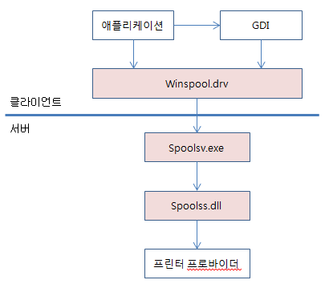

## windows7 이후(격리 도입)

이런 문제를 해결하기 위해, 각 드라이버들을 `PrintIsolationHost.exe` 라는 일종의 격리된 프로세스로 나누어 관리하는 방식이 도입되었다.

`PrintIsolationHost.exe` 는 평소에는 실행되지 않다가, 드라이버가 필요할 때 스플러가 이를 실행하는 방식이며 버그가 발생해도 스풀러가 다시 실행하면서 복구를 하므로 다른 서비스에 영향을 끼치지 않는다.

## 문제점

`PrintIsolationHost.exe`를 사용한 방식의 목적은 드라이버 하나가 시스템 전체(과거에는 커널, 도입 전까지는 스풀러)를 마비시키는 일을 막기 위한 격리 방식이지, 보안적 측면에서의 샌드박스하고는 거리가 멀다. 결국 외부 장치와 통신을 하므로 `PrintIsolationHost.exe`도 `SYSTEM` 권한으로 실행되고 이 점이 권한 상승의 통로가 될 수 있다.

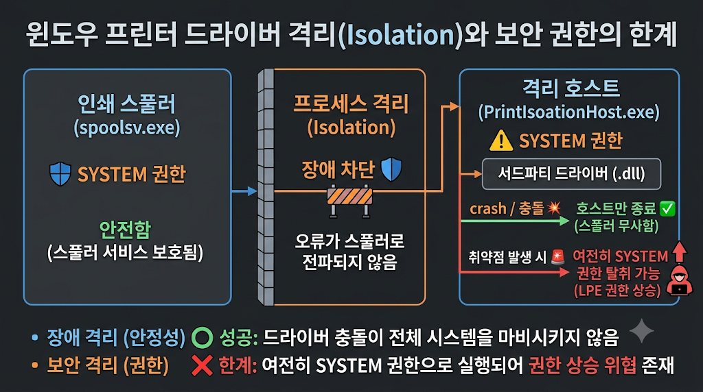

by gemini 4 hydrogen

# CVE-2019-19363 취약점 원인

앞선 드라이버 설명에서 볼 수 있듯, `PrintIsolationHost.exe`가 로드하는 dll이 취약하다면 LPE가 가능하고 이 취약점 역시 이 부분에서 문제가 발생한다.

RICOH의 드라이버에서 `PrintIsolationHost.exe`가 읽는 DLL은 `C:\ProgramData\RICOH_DRV\` 경로의 폴더에 존재하는데, 이 폴더와 그 폴더 안의 파일들 모두 일반 유저에게도 쓰기 권한이 주어져 있었던 점이 문제다.

쓰기 권한이 주어져 있다면, dll을 악성으로 변조하는 것도 가능하고 이를 통한 LPE가 가능하다. 다만 이는 타이밍을 잘 노려야 하는 것이 위 그림에서 볼 수 있듯 DLL 로드 시 에러가 나면 crash 이후 스풀러가 복구를 하므로 crash가 안나면서 dll을 로드하기 전 타이밍에 dll을 덮어씌워야 한다.

# 정적분석(드라이버 파일 분석)

사실 직접적으로 cve와 관련있다고 보긴 애매하지만, 한번 해 보고 싶어서 드라이버 자체를 분석해보았다.

정적 분석을 위해, 패치 전 드라이버와 패치 후 드라이버 파일을 구했다.

인스톨러 exe(ricu0qtl.exe, ricu0ntl.exe)는 완전 똑같은 파일이였는데, diff검사 안하고 무작정 이것부터 분석들어가서 거의 3일을 날려먹었다…. 덕분에 윈도우 SID권한설정에 관해서는 진득하게 알았다만

그 삽질 이후, 그러면 dll이 핵심인데 어떤 dll이냐가 문제이다. 여기서 [https://www.pentagrid.ch/en/blog/local-privilege-escalation-in-ricoh-printer-drivers-for-windows-cve-2019-19363/](https://www.pentagrid.ch/en/blog/local-privilege-escalation-in-ricoh-printer-drivers-for-windows-cve-2019-19363/)

위 링크의 분석에서 힌트를 얻었다. 마지막을 보면 `v4.26.0.0` 에서 전체 폴더 권한은 여전히 쓰기 가능이지만 dll과 `dlz` 디렉토리에 대한 권한이 추가되었다고 나와 있다. (위에서 말한 삽질에서 분석한게 이 전체 `RICOH`폴더 권한 설정 부분이다. 아마 다른 버전이면 이것까지 고쳤을 수 있긴 하다만 모든 버전을 노가다로 봐야 하기 때문에  추후 시간 나면 글로 쓸 것 같다.)

그래서 `dlz`라는 텍스트가 포함된 파일을 strings로 찾아보면 패치 후 버전의 `ricu0qui.dll`에만 
`"%s\\dlz\\%s"` 라는, 폴더 작업을 할 때 쓸 것 같은 문자열이 들어가 있다는 걸 알 수 있고 이게 핵심이라는 것까지 추측이 가능하다.

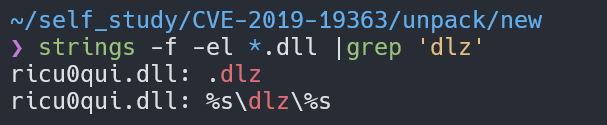

해당 파일은 구버전에서는 `ricu0nui.dll`이라는 이름이다.

일단 패치 후에만 `"%s\\dlz\\%s"`가 있으니, 신버전부터 분석해보자

내가 리버싱을 굉장히 못하고 윈도우는 더더욱 모르다보니 LLM이 1차 분석 하고, 따라갈 길을 제시해달라 한 뒤 그 길을 내가 직접 따라가는 방식으로 해보았다.

## IDA 분석

strings에서 `dlz`를 확인하고 xrefs를 확인하면 `sub_6154DA30`가 나온다.

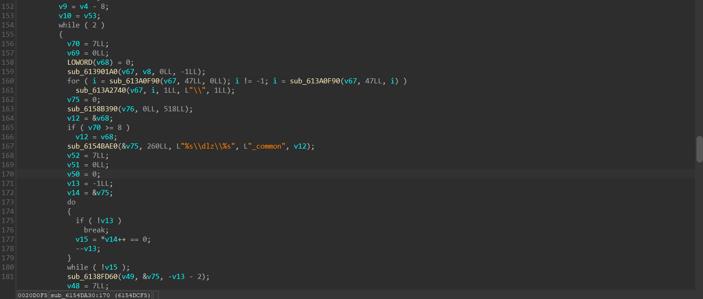

이 함수를 좀 살펴보면 아래와 같은 코드가 나온다.

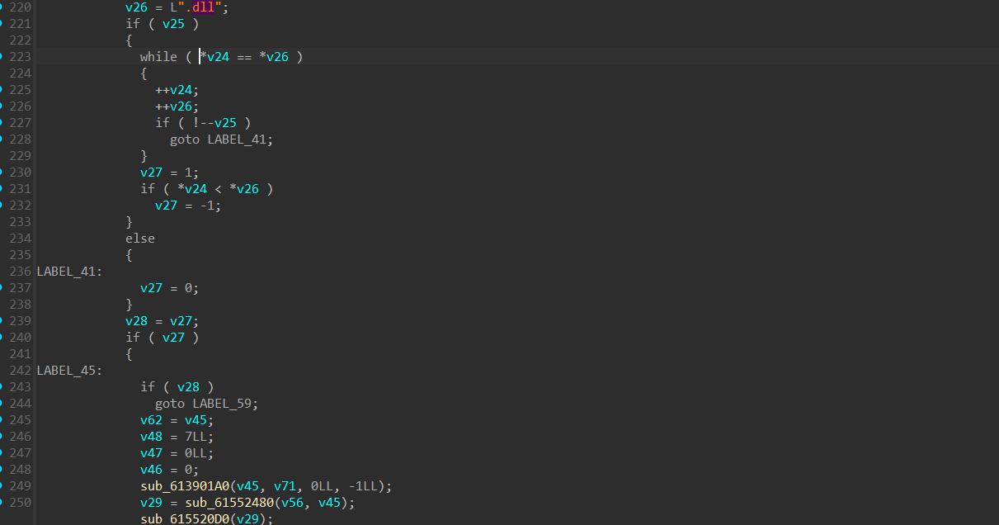

`v26`은 “.dll” 텍스트이고 `v24`와 문자열을 비교하고 `LABEL_45`로 이동하는데

그 중 아래쪽의 `sub_615520d0`에서 폴더 생성을 하는걸로 추측되는 코드가 있다.

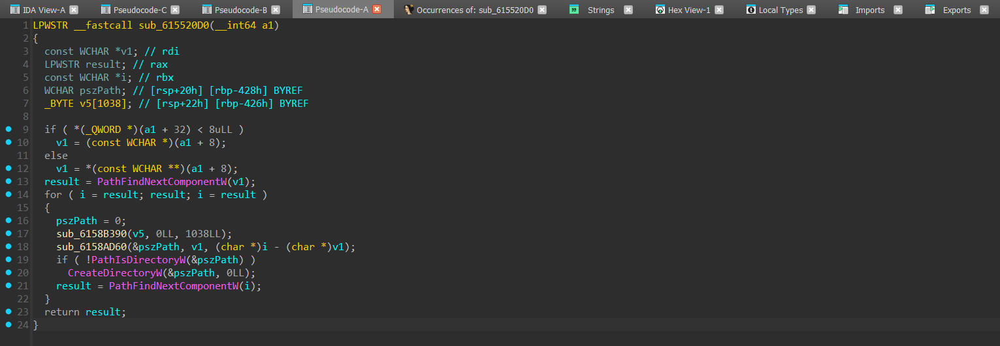

그러면 얼추 `sub_6154DA30` 는 dlz 관련 폴더 생성에 관한 함수라 할 수 있다.

이 함수에서 또 xrefs를 가면 `sub_6154C220` 이 나오는데 3종류의 함수를 4번 연속해 실행한다(`sub_6154E790`을 전후로 2번 호출).

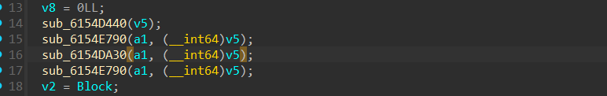

그 중 아래의 `sub_6154E790`을 보면 특정 폴더 경로에 대해 같은 작업을 반복한다.

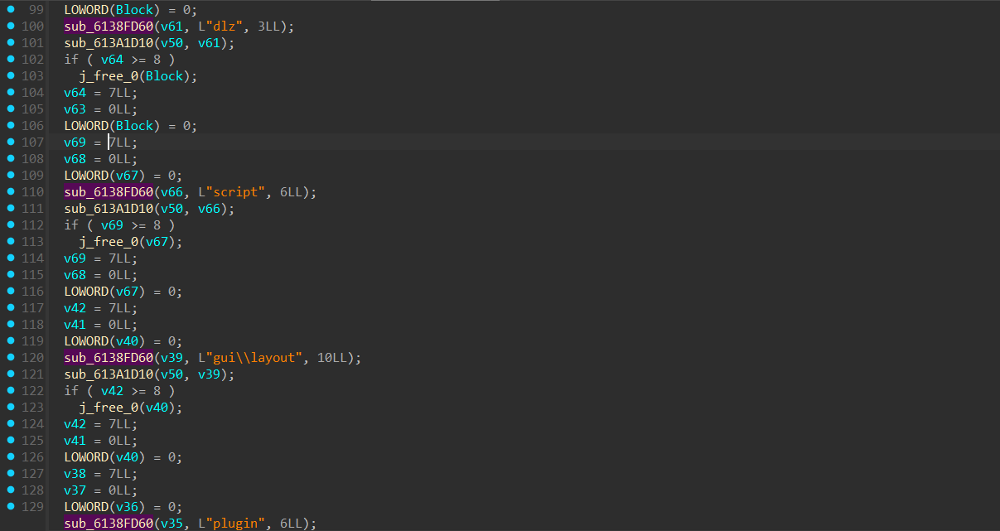

이 부분은 뭔지 전혀 알아먹을 수가 없었는데, LLM 이용해 물어보니 그냥 vector push_back하는 cpp STL함수라고 한다. 추후 보안 관련 적용할 폴더의 리스트를 vector에 push하는 것이라 하는데… 내가 리버싱을 못하긴 하지만 이런건 어떻게 알아보는지 모르겠다.

일단 `v50`이라는 vector에 각 경로들을 배열로 넣고, 그 시작점이 `v51`이다(이후 접근시 v51포인터부터)

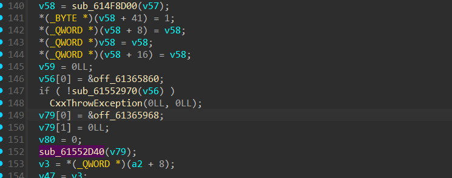

아무튼, 그 후 코드가 쫙 있는데, if쪽은 예외처리 확인용같고 그 다음의 `sub_61552D40` 인데, 코드가 다음과 같다.

```c
bool __fastcall sub_61552D40(__int64 a1)
{
  HANDLE CurrentProcess; // rax
  BOOL v3; // eax
  void *v4; // rdi
  struct _TOKEN_PRIVILEGES NewState; // [rsp+30h] [rbp-18h] BYREF
  HANDLE TokenHandle; // [rsp+50h] [rbp+8h] BYREF
  _LUID Luid; // [rsp+58h] [rbp+10h] BYREF

  if ( !*(_QWORD *)(a1 + 8) )
  {
    CurrentProcess = GetCurrentProcess();
    v3 = OpenProcessToken(CurrentProcess, 0x20u, &TokenHandle);
    if ( !v3 )
      return v3;
    *(_QWORD *)(a1 + 8) = TokenHandle;
  }
  if ( !*(_BYTE *)(a1 + 16) )
  {
    v4 = *(void **)(a1 + 8);
    if ( !LookupPrivilegeValueW(0LL, L"SeTakeOwnershipPrivilege", &Luid)
      || (NewState.Privileges[0].Luid = Luid,
          NewState.PrivilegeCount = 1,
          NewState.Privileges[0].Attributes = 2,
          !AdjustTokenPrivileges(v4, 0, &NewState, 0x10u, 0LL, 0LL))
      || GetLastError() == 1300 )
    {
      LOBYTE(v3) = 0;
      return v3;
    }
    *(_BYTE *)(a1 + 16) = 1;
  }
  LOBYTE(v3) = 1;
  return v3;
}
```

여기서 

```c
CurrentProcess = GetCurrentProcess();
v3 = OpenProcessToken(CurrentProcess, 0x20u, &TokenHandle);
```

이 부분은, 현재 프로세스에서 토큰은 가져와 `TokenHandle`에 저장하는 코드

```c
 if ( !LookupPrivilegeValueW(0LL, L"SeTakeOwnershipPrivilege", &Luid)
      || (NewState.Privileges[0].Luid = Luid,
          NewState.PrivilegeCount = 1,
          NewState.Privileges[0].Attributes = 2,
          !AdjustTokenPrivileges(v4, 0, &NewState, 0x10u, 0LL, 0LL))
```

여기서 `AdjustTokenPrivileges` 이전은 모두 이 함수 실행을 위한 준비로, `SeTakeOwnershipPrivilege` 권한 접근을 위한 `Luid`를 설정하고 그걸 활성화시키는 과정이다.

`SeTakeOwnershipPrivilege` 는 소유 권한을 바꿀 때 필요한 권한으로, 이 패치에서는 `RICOH` 폴더 산하의 `dlz` 폴더의 권한을 따로 설정하기 때문에 이런 코드가 있는걸로 보인다.

이후 코드는 다음과 같은 while문 안에서 돌아간다. `v51`이 폴더 이름 들어가있는 vector 시작점이니, 위에서 저장한 폴더들마다 같은 작업을 하는 반복문이라 할 수 있다.

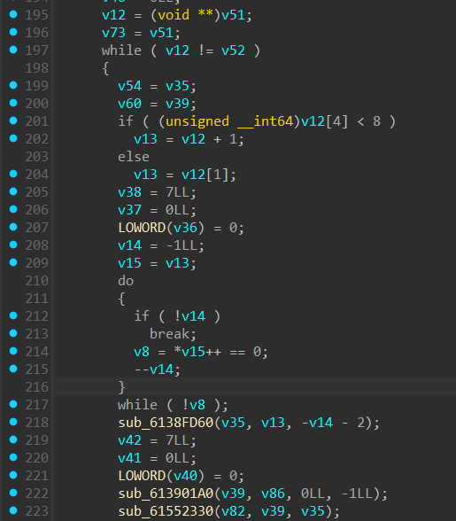

 여기서, v12에서 폴더명을 꺼내서 v13에 넣고, `sub_6138FD60(...)`을 수행하는데, 여기서도 함수가 도대체 뭐하는지 몰라서 LLM 질문을 하였고, 아래 `sub_61552330(...)` 까지 요약하면 이렇다고 한다.

```c
sub_6138FD60(v35, v13, ...);       // v35 재활용 ← "dlz" / "script" / "gui\layout" / "plugin"
sub_613901A0(v39, v86, 0LL, -1LL); // v39 재활용 ← "...\_common" 경로 (v86)
sub_61552330(v82, v39, v35);       // v82 = v39 + "\" + v35  (PathCombineW)
```

아마 위 vector처럼 STL쪽 코드가 아닐까 싶은데 역시 리버싱은 어렵다(사실 굳이 LLM안쓰고 이렇게까지 분석할 이유가?…)

아무튼 그 이후 `v17 = sub_615521B0(v82);` 호출을 하는데 해당 함수 내부는 다음과 같다`

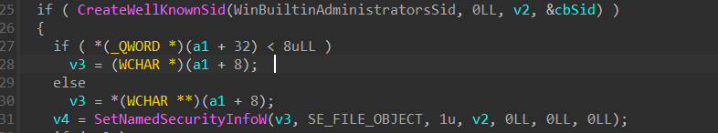

결과적으로 함수의 인자로 주어진 폴더/파일에 `WinBuiltinAdministratorsSid` 로 소유권을 변경한다

이로써 권한 수정이 가능해진다.

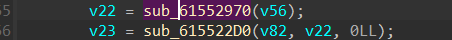

우선 `sub_61552970`은 `*a1+8`을 실행하는데 실행 주소는 결국 `sub_6154BBA0` 이다.

그래서 `sub_6154BBA0`를 보면

```c
v5 = (void *)sub_615529A0(a1, 22LL);
  if ( v5 )
  {
    memset(&pTrustee, 0, sizeof(pTrustee));
    BuildTrusteeWithSidW(&pTrustee, v5);
    v17 = 0x210000000LL;
    v18 = 3LL;
    sub_6154F1B0(v13, 0LL, 1LL, &v17);
    v4 = v16;
    v3 = v15;
    v2 = v14;
  }
```

위와 같은 구조의 코드가 4번 반복된다. LLM 말로는 구조체/vector 구조이고

“v17, v18, pTrustee는 이어져 있는 하나의 EXPLICIT_ACCESS_W 구조체”
”sub_615529A0(a1, 번호)로 Well-Known SID를 가져와서 위 구조체를 채운 뒤, 벡터(v13, 원소 크기 48바이트)에 push_back”
이라 설명한다.

`0x210000000LL` 은 모든 권한, `0x2A0000000LL` 은 rx(읽기 실행) 권한이라고도 하며 SID는 뒤 부분 포함 가져오는 SID가 22,26,17,27이며 각각 시스템, 관리자, 인증유저,빌트인 유저다.

결국 이걸 합치면 시스템/관리자에는 모든 권한을, 나머지는 읽기/실행 권한만 주는 ACL을 생성하고 이게 `v22`에 들어간다.

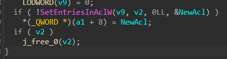

여러 폴더에 같은 행동을 반복하니 이렇게 미리 생성해 재사용 목적으로 보인다.

다음으로는 `sub_615522D0` 를 본다. 

```c
DWORD __fastcall sub_615522D0(__int64 a1, ACL *pDacl, char a3)
{
  unsigned int v3; // eax
  SECURITY_INFORMATION v4; // eax
  WCHAR *v5; // rcx

  v3 = 0x80000000;
  if ( a3 )
    v3 = 0x20000000;
  v4 = v3 | 4;
  if ( *(_QWORD *)(a1 + 32) < 8uLL )
    v5 = (WCHAR *)(a1 + 8);
  else
    v5 = *(WCHAR **)(a1 + 8);
  return SetNamedSecurityInfoW(v5, SE_FILE_OBJECT, v4, 0LL, 0LL, pDacl, 0LL);
}
```

`a3`은 0이니, `v4`는 0x80000004 이 되는데, 이걸 LLM한테 물어보니 다음과 같이 설명해준다.

```c
  0x00000004  DACL_SECURITY_INFORMATION            (DACL 권한 목록을 변경함)
| 0x80000000  PROTECTED_DACL_SECURITY_INFORMATION  (상위 폴더의 권한 상속을 차단함)
────────────
  0x80000004
```

그러니까, 상위 폴더가 하위 폴더/파일에 권한 상속을 하지 않도록 권한을 갱신한다는 뜻이다.
그리고 그 대신 뒤의 `pDacl`, 즉 `v22` (시스템/관리자에는 모든 권한을, 나머지는 읽기/실행 권한)으로 설정한다.

취약점 설명에 나왔듯 상위 `RICOH` 폴더가 전체권한이고 하위 DLL들이 이를 상속받아 근본적 원인이 발생하는 것이였으니, 이를 방지하기 위한 코드다.

마지막으로 볼 곳이 `sub_6154E350` 인데

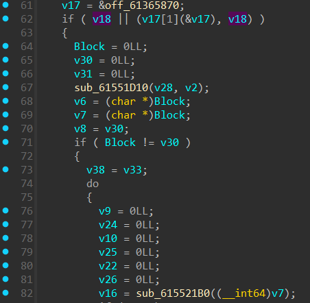

v17 부분은 위에서처럼 가상함수 호출이고 비어있는 dacl을 생성한다고 한다(LLM발)
그리고 `v2`는 `a2` 이며 호출을 보면 폴더 경로란 것을 알 수 있다.
`sub_61551D10(v28, v2);` 에서는 해당 함수가 폴더 내의 파일 목록을 `v28` 이라는 벡터에 넣는 코드라고 한다(LLM발)

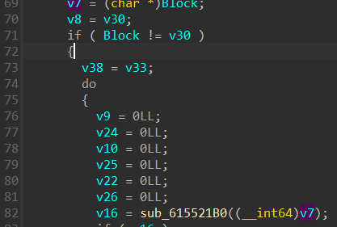

그 후 v7 시작으로 v28 쫙 돌면서 하위 파일들을 `sub_615521B0`으로 도는데 

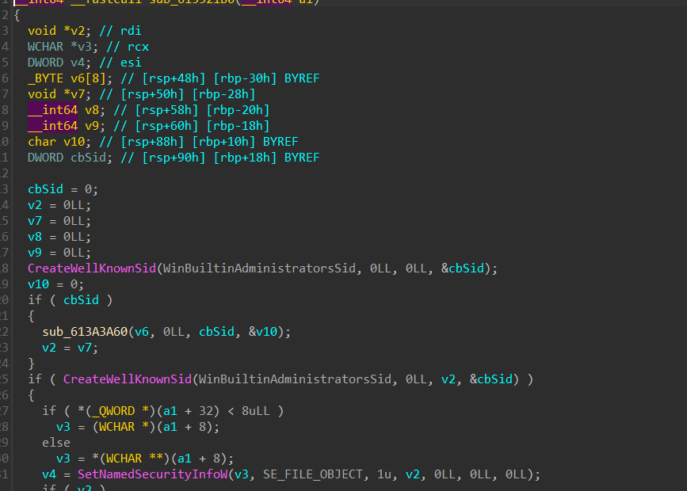

위에서 한 번 언급했던 소유자 변경이다.

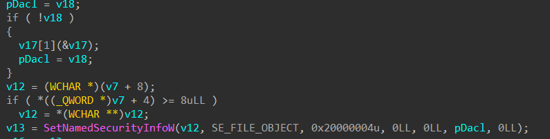

그리고 `0x20000004u` 즉 위에서 말한 상속 허용 및 DACL이 비게 되는데 이러면 파일 설정 이전 폴더에 설정한 권한이 이 파일들에게 그대로 상속되어 폴더와 그 파일들은 권한 설정이 안전하게 된다.

## 구버전/신버전 비교

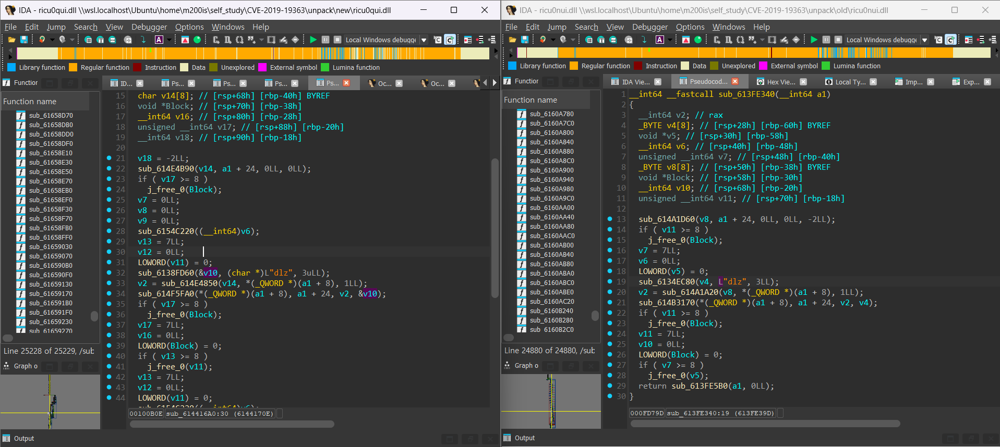

좌측이 신버전, 우측이 구버전이다.

권한을 조정하는 `sub_6154C220` 등이 추가된 점 이외에는 차이가 없는데, 이 `sub_6154C220`가 권한 조정을 하여 취약점을 패치하는 함수이므로 이 함수가 없는 구버전은 RICOH 폴더 아래의 모든 폴더/파일이 전체권한이였단 걸 알 수 있다.

## 추가)

위에서 전제조건으로 RICOH 폴더가 전체 권한이라고 했는데, 이부분은 exe파일에서 일부 단서를 찾았다.

Import 탭에서 Security, Directory 키워드를 검색하면 몇 개의 함수가 있다.

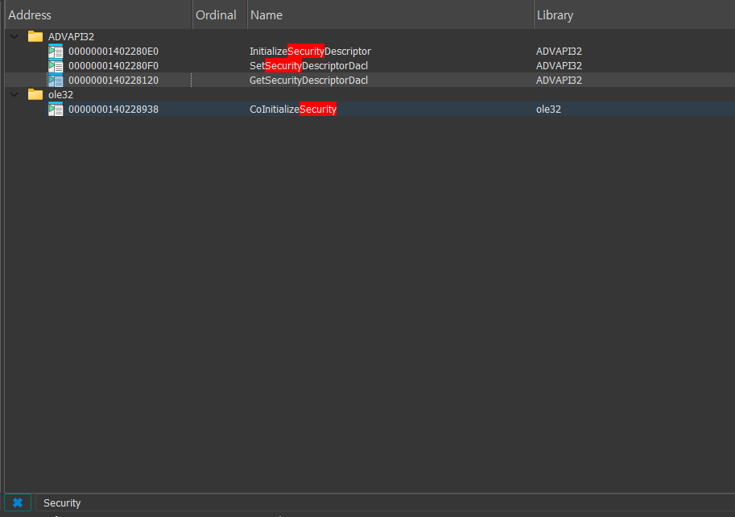

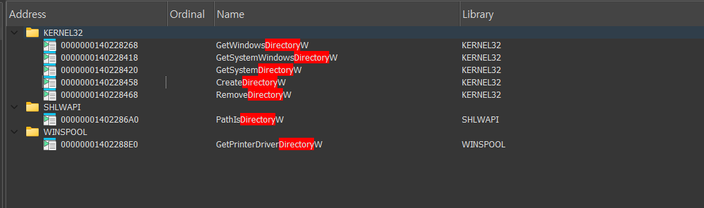

이 중 `CreateDirectoryW`를 xref로 호출되는 함수를 보면 `sub_14004FCB0` 에서 가장 많이 호출한다(호출하는 함수가 하나 더 있는데 IDA가 터지는지 응답없음이 뜨고, 추후 언급하겠지만 이 함수만으로도 지금 분석에선 충분하다)

이 중 눈에 띄는 부분은 line108이다.

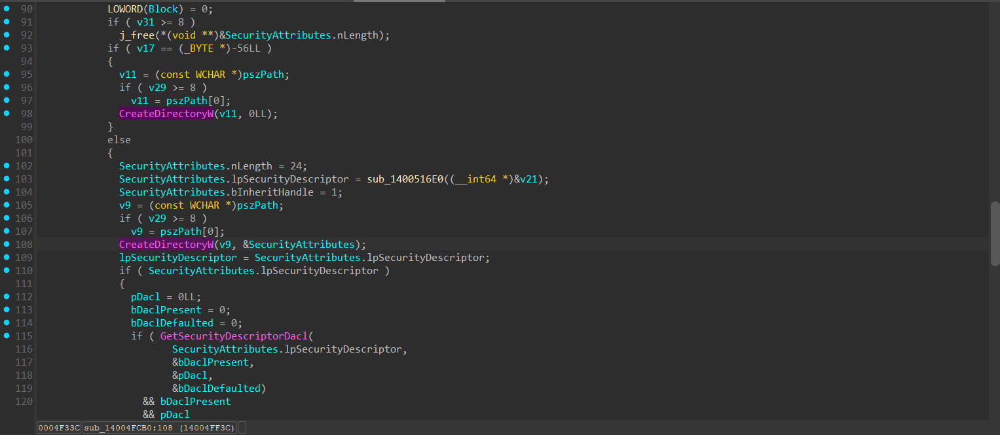

다른 부분은 2번 인자가 0이지만 여기서만 `&SecurityAttributes`가 인자이다.
0인 경우는 부모 폴더의 속성을 그대로 이어받는데, 드라이버 데이터 폴더는 `C:\ProgramData\RICOH_DRV` 아래에 생성되므로 기본 설정대로라면 일반 사용자의 쓰기 권한이 제한될 것이다.

그러면 저기서 설정하는 `&SecurityAttributes`가 핵심으로 보인다.

SecurityAttributes는 Windows API에서 보안 속성을 지정할 때 사용하는 구조체이며 위를 보면 구조체의 값들을 설정하는 것을 볼 수 있다.

```c
SecurityAttributes.nLength = 24;
SecurityAttributes.lpSecurityDescriptor = sub_1400516E0((__int64 *)&v21);
SecurityAttributes.bInheritHandle = 1;
```

`nLength`는 구조체 크기, lpSecurityDescriptor는 실제 폴더 권한을 담는 보안 설명자(핵심), bInheritHandle은 자식 프로세스로의 핸들 상속 여부다(CreateDirectoryW는 핸들을 반환하지 않으므로 여기서는 크게 중요하지 않다).

`sub_1400516E0`을 보기 전에 `v21`부터 확인하고 넘어가자.

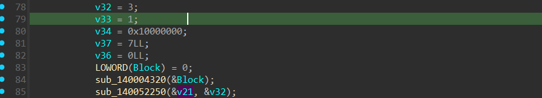

`v21`은 `sub_140052250`으로 에서 지정되는데, 앞의 `v32`~ `v37` 은 연속되서 위치한다.

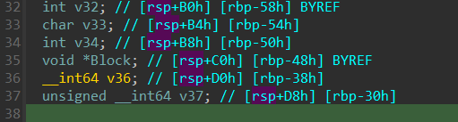

매우 강하게 구조체로 추측되지만 아직 확실히는 모르니 `sub_140052250`을 보면

```c
void __fastcall sub_140052250(unsigned __int64 *a1, unsigned __int64 a2)
{
  unsigned __int64 v4; // rcx
  __int64 v5; // rdi
  __int64 v6; // rdx
  unsigned __int64 v7; // rcx
  _QWORD *v8; // rcx
  unsigned __int64 v9; // rcx
  _QWORD *v10; // rcx

  v4 = a1[1];
  if ( a2 >= v4 || *a1 > a2 )
  {
    if ( v4 == a1[2] )
      sub_140052390(a1);
    v9 = a1[1];
    if ( v9 )
    {
      *(_DWORD *)v9 = *(_DWORD *)a2;
      *(_BYTE *)(v9 + 4) = *(_BYTE *)(a2 + 4);
      *(_DWORD *)(v9 + 8) = *(_DWORD *)(a2 + 8);
      v10 = (_QWORD *)(v9 + 16);
      v10[3] = 7LL;
      v10[2] = 0LL;
      *(_WORD *)v10 = 0;
      sub_140004320(v10);
    }
  }
  else
  {
    v5 = (__int64)(a2 - *a1) / 48;
    if ( v4 == a1[2] )
      sub_140052390(a1);
    v6 = *a1 + 48 * v5;
    v7 = a1[1];
    if ( v7 )
    {
      *(_DWORD *)v7 = *(_DWORD *)v6;
      *(_BYTE *)(v7 + 4) = *(_BYTE *)(v6 + 4);
      *(_DWORD *)(v7 + 8) = *(_DWORD *)(v6 + 8);
      v8 = (_QWORD *)(v7 + 16);
      v8[3] = 7LL;
      v8[2] = 0LL;
      *(_WORD *)v8 = 0;
      sub_140004320(v8);
    }
  }
  a1[1] += 0x30LL;
}
```

좀 뭐가 많지만 간단히 설명하면 `v32`~ `v37` 의 내용을 `v21`의 뒤에 이어붙인다.
그리고 마지막에 `+=0x30LL`을 하는 걸로 봐서 더더욱 구조체 의심이 가고 구조체의 총 크기가 0x30을 의심할 수 있는데 마침 `v32`~ `v37`의 크기도 0x30이다. 

사실 IDA 구조체처리하 맞긴 하지만 내가 리버싱 능력이 좋지 못한 관계로..(+REA같은 AI 자동화는 공부에선 쓰고싶지 않다)

아무튼 다음으로 넘어가 보자

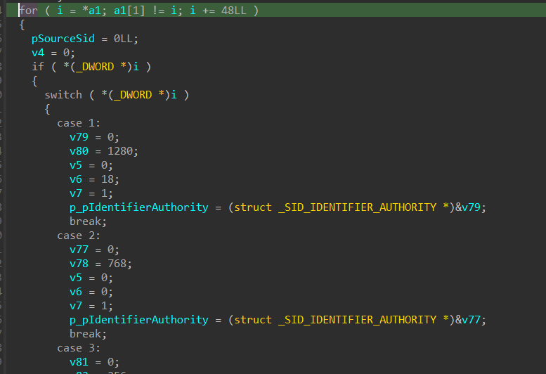

구조체라는 사실을 알게 된 이후 이건 `a1(v21)`이라는 구조체 배열의 원소를 i에 넣으며 순회하는 for문이란 걸 알 수 있다. v21에서는 `v32`가 3이었으니 우리는 `case 3`을 보면 된다.

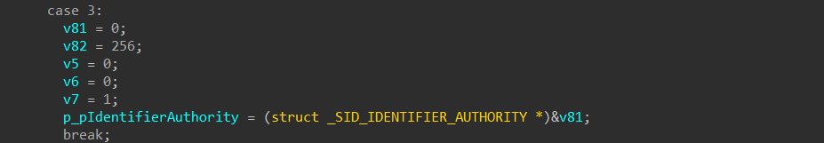

이건 그냥 구조체다.

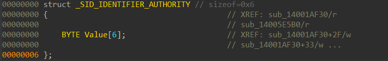


이후 해당 구문을 실행하는데 

우선 다음 코드를 보자, 마이크로소프트 공식 문서의 Well-known SID 예제 코드이다

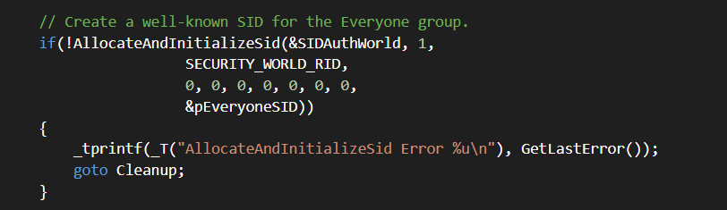

`SECURITY_WORLD_RID` 같은 경우 기본 선언된 값으로 0이며, `S-1-1-0` 으로 설정하는 코드인데 위의 코드와 똑같다. 그리고 `S-1-1-0`은 Everyone(World)를 뜻하면 Everyone 그룹(모든 사용자)에게 열려있도록 권한 설정을 하는 것이다.

# PoC 통한 재현

pentagrid의 PoC는 [링크](https://www.exploit-db.com/exploits/47962)에서 얻을 수 있다. 

### PoC가 뭘 하는가

해당 PoC는 인자로 세부 사항(드라이버 경로, 대체 dll 경로, 드라이버 이름 등)을 받는다.

그 후 드라이브 폴더의 변화를 지켜보다가, 특정 횟수만큼 `watermark.dll`의 수정이 발생하면 `CopyFile`로 대체할 DLL을 덮어쓰는 방식이다.

```c
BOOL WINAPI DllMain( HMODULE hModule,
                       DWORD  ul_reason_for_call,
                       LPVOID lpReserved) {
    WinExec("cmd.exe /c whoami > c:\\result.txt", SW_HIDE);
    return TRUE;
}
```

덮어쓰는 DLL은 위와 같이, C:\\ 경로에 whoami 실행 결과를 담은 txt파일을 생성해 해당 dll이 어떤 권한에서 실행되었는지 확인할 수 있다.

### 컴파일

최신 버전 컴파일러에서 오류가 나는 일부 부분을 수정(`void` 함수를 `DWORD` 로 바꾸는 정도)한 것 이외에는 그대로 사용했다.

windows에서 돌아가야 하므로, gcc나 clang이 아니라 x64 Native Tools Command Prompt로 컴파일을 해야 한다.

```powershell
cl /nologo /EHsc /DUNICODE /D_UNICODE /FePoC.exe 47962.cpp Shell32.lib
cl /nologo /LD /FeDll.dll Dll.cpp
```

우선, 가상머신에 취약한 드라이버를 통해서 프린터 하나를 추가해 놓은 상태이다.

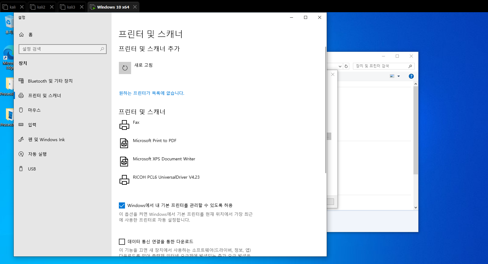

여기서 중요한 것이 poc 전에 설정에 뜨는 저 RICOH 프린터 삭제를 해야 한다. 그래야 poc가 프린터 추가를 정상적으로 한다. 이 점을 간과해서 상당히 많이 애먹었다.

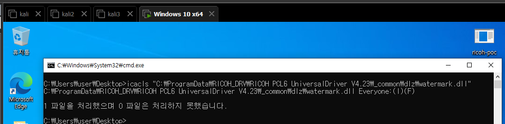

우선 덮어쓸 watermark.dll은 권한이 모두 쓰기까지 열려 있다.

여기서 PoC.exe를 실행하면

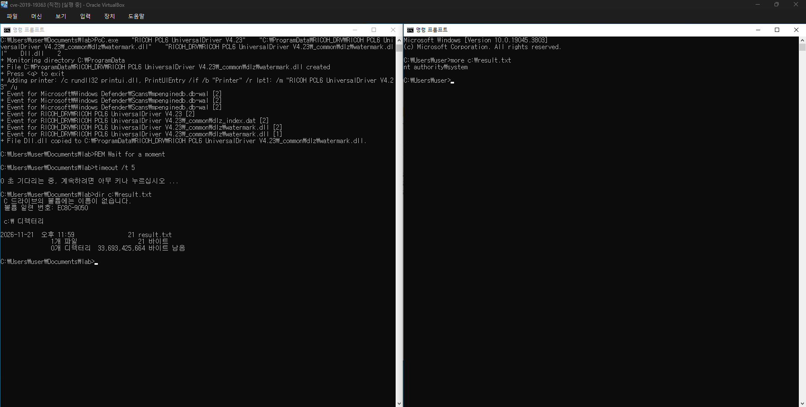

위처럼 `result.txt`가 생성되고 그 내용이 `nt authority\system` 즉 관리자 권한으로 생성되었단 것을 볼 수 있다.

# 패치 및 대응/탐지 방법

## 패치

앞선 드라이버 정적분석에서 볼 수 있지만, 패치 방법은 가장 근본적인 원인인, `C:\ProgramData\RICOH_DRV` 폴더 내의 dll을 일반 사용자 권한으로 수정하지 못하게 하는 것이다. 좀 더 안정성을 위해서라면 그냥 드라이버 관련된 파일을 최대한 관리자 권한으로 놓고 수정하지 못하게 하는 것이 확실하지만 내가 분석한 패치 버전에서는 `RICOH_DRV` 내의 일부 폴더/파일들만 수정했고 상위 폴더 자체의 권한은 여전했다.

## 대응/탐지

### 사전 탐지/예방

사전에 이런 취약점이 있는지 확인하려면, 드라이버 관련 파일들의 권한을 확인해야 한다. (이번 취약점의 경우 `RIOCH` 폴더 내의 파일들) 그리고 권한 뿐 아니라 무결성 검사로, 모르는 사이에 파일이 변조되어 있지는 않은지 확인해야 한다.

### 사후 탐지

이미 취약 버전을 받은 뒤에 공격 여부를 확인하려면 공격 시 발생하는 행동이 일어났는지 확인해야 한다.
이 취약점이면 dll 파일의 변조가 일어났을 것이니, 파일의 수정 기록을 확인해 의도하지 않은 파일 수정 기록이 있다면 공격이 발생했을 것이란 유추를 할 수 있다.

# 후기

과거 원데이 LLM으로만 분석하고 옮겨적기 하다가 후회한 적이 있어 이번에는 조언 위주로 직접 해봤는데 정말 어려웠다. 특히 드라이버 파일 정적분석에 시간의 80%는 사용한 것 같다. 
리버싱을 내가 못하긴 하지만 그래도 상당히 흥미로운 과정이였고 그 과정에서 윈도우 시스템에서 권한을 다를 때 어떤 함수를 사용하고 어떻게 관리되는지를 알게 된 것 같다.

참고자료/LLM:

[https://nvd.nist.gov/vuln/detail/cve-2019-19363](https://nvd.nist.gov/vuln/detail/cve-2019-19363)

[https://www.pentagrid.ch/en/blog/local-privilege-escalation-in-ricoh-printer-drivers-for-windows-cve-2019-19363/](https://www.pentagrid.ch/en/blog/local-privilege-escalation-in-ricoh-printer-drivers-for-windows-cve-2019-19363/)

[https://www.exploit-db.com/exploits/47962](https://www.exploit-db.com/exploits/47962)