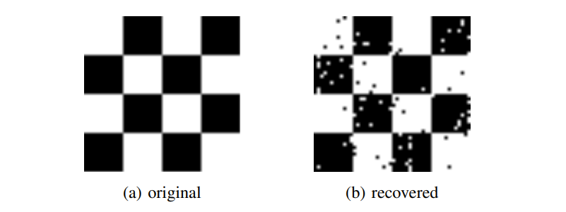

# 논문 정리

## 논문 정보
제목: Scheduled Disclosure: Turning Power Into Timing Without Frequency Scaling

발표 학회: 2025 IEEE Symposium on Security and Privacy

저자:　I. Chun, I. Siu and R. Paccagnella

Link: https://ieeexplore.ieee.org/document/11023498
## 초록(연구 배경)

전력 사이드채널 공격은 최근 다시 관심을 받는중이다.  이 공격 방식은 전력 소비를 모니터링하고 전력 소비가 두드러지는 타이밍/주파수 변동을 이용한 공격. 다만 이전까지는 구형 x86 CPU에서 실증되었지만, 최신 CPU에서도 적용이 가능한지에 대한 여부는 이전까지 실증되지 않았다. 이 논문에서는 최신 CPU에서도 전력 사이드채널 공격이 가능하며, 심지저 이전보다 더 빠른 방식으로 가능하다는 것을 보여준다.

## 공격 방식 이전 배경지식들

### 이전 공격 방식

전통적으로는 오실로스코프 등으로 전력을 측정해야 했고, 이후 원격으로 전력 소비를 추론하는 방식의 공격을 실증, 이 방식으로 암호화 키, 핑거프린팅, KASLR 우회, Meltdonw 등이 이에 해당한다.

크게 x86에서의 전력사이드채널 공격의 분류는 2가지이다

1. RAPL
    1. 소프트웨어에서 프로세서의 전력 소비를 측정할 수 있게 해주는 기능이나 접근 제한+노이즈로 인해 해결
2. Hertzbleed
    1. CPU가 전력 소비/발열이 한계 이상으로 올라가지 못하도록 제한할 때 발생하는 CPU의 주파수 변동을 통해서 전력 소비를 간접적으로 측정하는 방식

그러나 Hertzbleed 방식에서는 전력/발열 제어 메커니즘이 구형 x86에서만 실증되어 있고 최신 x86 CPU의 방식은 실증되어 있지 않았다.

## Thread Director

#### 기본 동작

Thread Director는 마이크로초 단위로 명령어 조합에 기반에 스레드에 4개의 클래스 ID중 하나를 할당한다.

프로세서가 전력 제약을 받고 CPU가 특정 주파수 이상으로 실행이 불가능 할 때, Thread Director는 CPU 주파수를 더 낮추지 않고 축소된 코어 set을 이용할 것을 권하는 idling hints를 OS에 제공한다.

이 hint는 CPU, GPU 포함 전체 프로세서의 전력 소비에 의존한다.

그리고 windows 스케줄러는 서로 다른 클래스 ID를 가진 스레드에 대해서 P-코어에서 서로 다른 우선순위를 가진다.

그리고 WIndows는 idling hints가 있는 코어에는 스레드를 스케줄링하지 않는다. 결국 전력 소비에 따라 평균 활성 코어 수가 달라진다.

#### Thread Director 테이블

Thread Director Table이란, 각 코어/Class별 성능 지표와 효율 지표를 0~255로 담는 메모리 테이블이다.

저자들은 CPU/GPU에 다양한 종류의 부하를 주면서, 활성 코어 수와 주파수/전력 소비/효율의 관계를 측정하였고, Table의 유형을 크게 3가지로 나누었다.

또한 Table마다 windows가 어떻게 스케줄링을 하는지도 분석했다.

1. Default Capabilitys(기본 능력치)
    1. 스로틀링이 발생하지 않는 경우, 전력 소비에 의존 X
    2. 기본적으로 P코어에 우선 배치한다.
    3. 만약 P코어가 모자른 경우 같은 class면 라운드-로빈, 다른 경우 Class1>Class0>Class3 우선순위
2. Dynamic Capabilitys(동적 능력치)
    1. 스로틀링 시 나타남, 전력 소비에 의존은 하지만 P코어, E코어의 우선순위에는 영향이 미미하다.
    2. 우선순위에는 영향이 미미해 기본일 때와 차이 없음
3. Idling Hints(유휴 힌트)
    1. 2가지 경우에 발생
        1. GPU가 활성화되어 있고 8개 이하의 활성 CPU 코어가 있을 때 P0-1에서 일관적으로 발생
        2. 프로세서가 스로틀링하고 적어도 하나의 코어의 P-state(주파수)가 특정 값 아래로 떨어질 때 E6-7, 혹은 E7을 제외한 모든 코어에서 순차적 발생
    2. 발생한 코어의 capability를 0으로 설정한다.
    3. 코어의 점수가 0인 경우 해당 코어에 Windows는 스레드를 배치하지 않는다.(단 해당 코어에만 배치해야 하는(pin된)스레드는 예외)

이 내용을 표로 정리하면 다음과 같다.

| 부하(Stress) 조건 | Thread Director 테이블(능력치) 상태 | Windows OS 스케줄러 반응 및 결과 |
| --- | --- | --- |
| 부하 없음 (스로틀링 X, 기본 상태) | **기본 능력치 (Default):** 전력 무관하게 고정값. 항상 P-코어 > E-코어 | 모든 코어 정상 사용. P-코어 우선 할당 |
| 일반 CPU 부하 (스로틀링 O) | **동적 능력치 (Dynamic):** P-state/전력에 따라 수치 변동. 순위(P-코어 > E-코어)는 유지 | 모든 코어 정상 사용. 활성 코어 수나 P-core 사용량에 유의미한 변화 없음 |
| 메모리 집약적 CPU 고부하 (스로틀링 O, P-state 임계치 하락) | **유휴 힌트 (Idling Hints) 발생:** P0부터 E-코어 쪽으로 순차적으로 코어 능력치를 0으로 설정 | 능력치가 0이 된 코어에 스레드 할당 중단 → **전력 소비량에 따라 활성 코어 수가 동적으로 진동/감소** |
| 내장 GPU 활성화 + 부하 (활성 CPU 코어 8개 이하) | **유휴 힌트 즉시 발생:** 전력과 무관하게 항상 P0, P1 코어 능력치가 '0'이 됨 | P0, P1 코어 즉시 유휴(Idle) 상태 |
| 내장 GPU 활성화 + 부하 (스로틀링 O, P-state 임계치 하락) | **유휴 힌트 확산:** P2(또는 P0)부터 나머지 코어(마지막 E-코어 제외)로 유휴 힌트 확산 | 대부분의 CPU 코어 사용 중단. GPU가 고전력 워크로드일수록 유휴 상태 진입이 더 빠르고 넓게 나타남 |

## 은닉 채널

은닉 채널이란, 보안 정책이나 구조를 우회하여 허용되지 않은 방식으로 정보를 주고받는 통신 채널을 말한다.

해당 논문에서는 Thread Director와 Windows OS가 Class ID에 따라 P코어 우선순위를 다르게 두는 특성을 악용하여 은닉 채널을 구축하였다.

### 동작 방식

#### 1. 송/수신자 구성

수신자는 특정 Class ID를 가지는 스레드를 실행하면서 Windows API로 자신이 어떤 코어에서 실행중인지 확인한다.

반면 송신자는 전송하려는 비트의 값에 따라서 실행하는 명령어의 Class ID를 조절한다.

### 2. 통신 원리

#### 0을 전송할 때

송신자는 수신자의 명령어와 비교해서 P코어에서 우선순위가 같거나 더 높은 Class ID를 가진 명령어 루프를 실행한다. 이 경우 OS 스케줄러는 송신자에게 P코어를 우선적으로 할당하기 때문에 수신자는 P코어에서 쫓겨난다.

#### 1을 전송할 때

송신자는 수신자의 명령어와 비교해 P코어에서 우선순위가 같거나 더 낮은 Class ID를 가진 명령어 실행한다. ‘0’때와 반대로, 수신자가 P코어를 차지하고 송신자가 쫓겨난다.

#### 해독

수신자는 정해진 시간 동안 자신이 P코어에 머문 시간을 측정한다. 만약 P코어를 점유한 시간이 더 길다면, 송신자가 ‘1’을 전송했다고 해석하고, 반대의 경우 ‘0’을 전송했다고 해석한다.

### 3. 성능

연구진의 PoC 모델에서, 이 방식에서 최대 16.62bps의 대역폭을 구현하였다. 특별히 높은 것은 아니고 낮은 편에 속하지만 공유 자원/타이버에 영향이 없기 때문에 결과적으론 다른 은닉 채널과 비슷한 수준의 성능이다.

## SIKE 원격 타이밍 공격

SIKE(Supersingular Isogeny Key Encapsulation)이란, 타원곡선 기반의 양자내성 암호 키 캡슐화 메커니즘이나 지금은 해독된 알고리즘이다.(여기서는 이전의 부채널 공격 방식과 비교하기 좋은 역할을 하기 때문에 사용하였다고 한다.)

### 공격 방식

#### 1. 조작 암호문 전송  
공격자는 타겟 SIKE 서버에 300개의 동시 복호화 요청을 조작된 암호문과 함께 전송한다. 이 암호문은 서버가 복호화를 할 때, 비밀키의 인접한 두 비트 값이 서로 다를 때 연산 과정에서 수많은 '0'을 처리하도록 설계한 암호문

#### 2. 전력 소모량 차이로 인한 유휴 힌트 차이 
인텔의 CPU는 기본적으로 1의 개수가 많을수록, 비트 반전이 많을수록 전력 소모량이 늘어난다.  
그런데 전송한 암호문은 비밀키의 두 비트 값이 다를 때는 수많은 '0'을 처리하므로 전력 소모량이  줄어들에 되고, 스로틀링도 줄면서 유휴 힌트의 발생 횟수가 줄어든다. 
반대로, 비밀키의 두 비트가 같으면 전력 소모량이 비교적 많고 유휴 힌트 발생 수도 증가한다.

#### 3. 활설 코어 변화를 통한 키 해독 
유휴 힌트가 발생한 코어에는 스레드 할당을 중지하고, 결국 활성화된 코어의 개수 자체가 줄어든다.  
확설 코어가 줄어들면 서버 자체의 성능이 줄어들어 응답이 비교적 늦어진다.  
이를 이용해 기존에 측정한 평균 응답 시간보다 짧다면 활성 코어가 많은, 즉 비밀키의 두 비트 값이 다르다는 것을 알 수 있고 반대로 길어지면 두 비트 값이 같았다는 것까지 알 수 있다.

이런 방식을 사용하면, 기존의 Hertzbleed와 달리 주파수 변화가 없는 상태에서도 공격이 가능하고 기존 대비 약 5배 빠른 7시간 8분만에 378bit 비밀킨를 추출하는 것에 성공했고, 주파수 고정 환경에서도 38시간 21분 만에 키를 획득하였다.

## 픽셀 탈취 공격

픽셀 탈취 공격이란, 브라우저의 SOP(Same-Origin Policy)를 우회해 공격자가 접근 권한이 없는 사이트의 픽셀 정보를 뺴내는 기법이다. 
기존의 방식은, 픽셀의 색상에 따른 렌더링 시간 차이를 측정하였으나 최근의 브라우저는 필터 연산을 상수 시간으로 처리해 방어하였다. 
하지만 연구진은, 시간 뿐 아니라 색상에 따른 GPU의 전력 소모량이 다르다는 것을 이용해 유휴 힌트를 엮어 최신 Chrome에서 공격을 성공했다.

### 공격 방식

#### 1. 픽셀 확대/SVG 필터
공격자는 탈취하려는 1x1 크기의 픽셀을 3000x3000의 크기의 iframe으로 강제 확대하고, 해당 픽셀을 흑백으로 바꾼 뒤 복잡한 시각 효과를 주는 SVG 필터를 씌워 반복적인 연산을 수행하도록 한다.

#### 2. GPU 전력 소모/스로틀링 유발
대상 픽셀의 흑백 여부에 따라 SVG 필터를 연산할 때 발생하는 GPU의 전력 소모량이 달라진다.  
흰색이 검은색에 비해 전력을 더 소모하는데, 이 경우 프로세서가 전력/온도 한계에 더 빨리 도달하여 스로틀링이 발생

#### 3. CPU 코어 유휴 힌트 발생
위 Thread Director Table 분석에서 알아낸 바와 같이, GPU 전력 소모로 인한 스로틀링이 발생하면 CPU는 다수의 코어에 유휴 힌트를 발생시킨다. 해당 논문에 따르면, 타깃 픽셀이 흰색인 경우 연산 시작 3.3초 이내에 유휴 힌트가 발생해 활성 코어가 감소한다.

#### JS 스크립트 연산 지연을 통한 색상 판별
위 단계를 거친 상황에서 브라우저에서 20개(사용한 CPU인 인텔 Ultra 155H의 하이퍼스레드 수)를 생성해 200ms동안 단순 덧셈을 몇 번 수행할 수 있는지 측정하였다. 
타겟 픽셀이 검은색이면 활성 코어가 비교적 많아 연산 수행 횟수가 많고, 흰색이면 활성 코어가 비교적 적어 연산 수행 횟수도 적다. 실혐 결과에서는 검은색이 약 2.4배 더 많은 연산을 하였다고 한다. 

이를 통해 픽셀의 색상을 알 수 있고 픽셀 복원이 가능하다.
연구진은 이 방식으로 약 96.3%의 정확도로 픽셀당 7.1초만에 타깃 화면 복구에 성공했다.

# 논문의 한계
부채널 공격의 특성상 한계라 하기는 뭣하지만, 해당 공격 방식은 최신 Intel 메테오레이크 CPU의 Thread Director 동작을 악용한 것이기 때문에 Intel 외의 AMD CPU나, Xeon 등 서버용 CPU에서는 이 공겨 방식은 적용되지 않는다. 그리고 비밀 키 탈취의 경우, SIKE가 비밀키의 비트 차이에 따라서 '0'의 연산을 조절할 수 있는 구조의 암호화 방식이였기 때문에 비밀키 획득이 가능하였는데, 역으로 말하면 이런 특수한 암호문을 만들지 못하는 방식의 암호화에서는 이 방식을 사용하기 어려울 수 있다.

# 소감

이 논문을 선정한 것은 전부터 사이드채널 공격에 대해서 상당히 관심을 가지고 있었기 때문에 선정했었다. 기존에는 사이드채널 공격이라 하면 단순히 전류를 가해서 검증 회로를 망가트리거나 우회하는 정도의 공격으로만 알고 있었지만, 이번 논문을 보면서 그런 종류의 공격 방식 뿐 아니라 하드웨어의 동작에 따른 성능 차이를 이용한 공격 또한 사이드채널 공격으로 가능하다는 것을 알게 되었다. 연산 시간을 통해 확인한다는 부분은 Blind SQL Injection에도 비슷하게 있지만, 특정 명령어 처리에 따른 코어/스케줄링을 활용할 수 있다는 생각을 하지 못하였기 때문에 정말 다양한 방식으로 공격이 가능하다는 것을 알았다.
직접 실습을 해 보기에는 힘든 종류의 공격이지만 추후 기회가 된다면 간단한 수준이여도 이런 사이드채널 공격에 대한 실습도 해보고 싶다.
